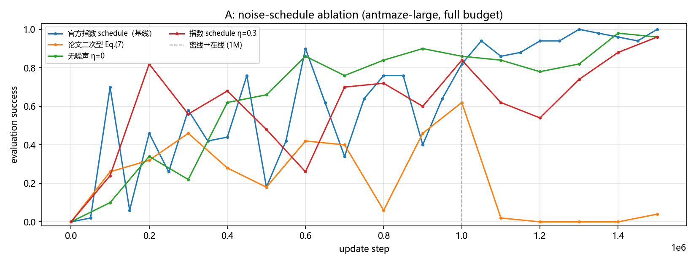

# FINO 复现报告框架（优化方法选题 · 中文）

> 课程大作业 Topic 1：*Introduce a new optimization method（principles / implementation / advantages & disadvantages / case study）*
> 选题：**面向离线到在线强化学习的生成式策略优化方法——FINO 的复现、审计与机制消融**
> 定位：不是"复现报告"，而是**以 FINO 为对象的优化方法研究**：把 flow matching 策略学习写成优化问题，复现其实现，审计论文与代码的一致性，并用原创消融检验机制的因果作用。
> 作者 / 日期 / 课程：＿＿＿＿
> 篇幅目标：正文 15–20 页（不含附录）；所有数字均来自本机实测（仓库 `E:\FINO`，可复现）

---

## 0. 摘要（约 150–200 字，待写）

要点：离线到在线 RL 的核心矛盾是"策略改进 vs 数据支持约束"；FINO 用**带噪声注入的 flow matching** 生成策略、**一步蒸馏**压缩推理、**Q-guided 采样 + 熵自适应 β** 做在线探索。本文从**优化视角**拆解 FINO：给出目标函数、正则项与对偶变量解释；在 WSL2 + RTX 5070 上按论文预算复现 3 个 OGBench 任务（antmaze-large FINO 100% vs FQL 92%）；发现并量化了**论文 Eq.(7) 噪声 schedule 与实现不一致**、**β 更新符号与论文 Eq.(9) 相反**；并设计了真实任务上的机制消融（A/B/C 组，结果待补）。结论：FINO 是一种**稳定的监督式生成策略优化**，其收益主要来自在线微调阶段的支持集扩展，但代价是 10 步推理、α/η 敏感与单步蒸馏误差。

---

## 1. 引言与动机（约 2 页）

### 1.1 问题背景
- 离线 RL：只有固定数据集，策略改进受"行为策略支持集"约束；离线→在线微调的目的是在少量在线交互中**既扩大支持集、又保持稳定**。
- 三类典型失败：① 分布外动作导致 Q 值高估；② 过度保守导致在线探索不足；③ 策略梯度方差大、在线微调不稳定。
- 因此这本质上是一个**带约束/带正则的优化问题**：`max_θ E[Q(s, π_θ(s))] − α·D(π_θ, π_data)`，不同算法是对 `D`、`α` 与优化器的不同选择。

### 1.2 为什么选 FINO（动机，需写得充分）
- FINO 是 2026 年 ICLR 的**新方法**，在 FQL（flow Q-learning）基础上加两处优化层面的设计：
  1. **噪声注入的 flow matching**：对概率路径的插值点加噪，把"数据端方差"从 0 变为 η²，从而**放松支持约束**、为在线探索提供可用动作；
  2. **Q-guided 多候选采样 + 熵自适应 β**：把动作选择写成 `softmax(βQ)`，β 作为**熵约束的对偶变量**在线调整。
- 它把 policy optimization 变成了"**回归 + 蒸馏 + 对偶更新**"的混合优化问题，非常适合作为优化课程的方法剖析对象。
- 我们已有完整复现条件（官方代码、OGBench 数据、WSL2+RTX 5070、3 个 1M 步 checkpoint），可以做**真实任务上的原创消融**，而不是纸上分析。

### 1.3 研究问题（对应作业要求）
- RQ1（principles）：FINO 的优化目标是什么？噪声注入/一步蒸馏/Q-guided+β 分别在优化中扮演什么角色？
- RQ2（implementation）：官方实现是否与论文描述一致？在真实任务上能否复现？
- RQ3（case study）：与 FQL 同预算对比，效果如何？在线微调的贡献有多大？
- RQ4（original）：三个机制的因果作用如何用消融检验？有哪些实现层面的问题？

### 1.4 本文贡献（原创性声明，单独成段）
1. 给出 FINO 的**优化解释**：噪声注入 = 输入平滑/方差正则（支持集扩大）；一步蒸馏 = 带 Lagrange 权重的策略压缩；β 更新 = 熵约束的**投影对偶上升**。
2. 完成**论文预算的全预算复现**（3 个 OGBench 任务，GPU，单任务 2.3–2.5 h），其中 antmaze-large FINO 100% vs FQL 92%。
3. **审计发现**：论文 Eq.(7) 的二次型噪声 schedule 与代码 `η·exp(10(t−1))` 不一致；β 更新方向与论文 Eq.(9) 印刷式相反；`to_eval` 在 batch>1 时全局 argmax；CsvLogger 丢列。
4. **原创消融设计**（真实任务，从 1M checkpoint 恢复，200k 在线步）：schedule / η、β 变体、Q-guided K —— 检验机制因果作用（结果见 §6，待补）。

---

## 2. 背景与问题形式化（约 3 页）

### 2.1 离线 RL 的约束优化视角
- 目标：`J(π)=E_{s∼dπ}[Q^π(s,π(s))]`；离线数据分布 `μ(a|s)`；约束 `D(π(·|s) ‖ μ(·|s)) ≤ ε`。
- 常见做法：CQL（惩罚 OOD Q）、IQL（expectile 回归避免 OOD 查询）、FQL（flow 生成策略 + Q 学习）。
- 约束/正则的 Lagrange 形式：`max_π min_β E[Q] + β(ε − D(π‖μ))`（为 §3.4 的 β 对偶解释铺垫）。

### 2.2 Flow Matching 作为优化问题
- 条件流匹配（CFM）目标：
  `L_CFM(θ) = E_{t∼U[0,1], x0∼N(0,I), x1∼π_data} [ ‖ v_θ(x_t, t) − (x1 − x0) ‖² ]`，其中 `x_t=(1−t)x0 + t x1`。
- 优化视角：这是一个**沿概率路径的回归问题**（stochastic least squares）；Euler 采样 `x_{k+1}=x_k + v_θ(x_k,t_k)/K` 是**推理时的数值积分**，K=10。
- 生成策略 vs 高斯策略：表达多模态动作分布，但推理成本高（K 步），需要蒸馏。

### 2.3 FINO 的单步总目标（公式-代码映射）
- 训练目标：`L = L_critic + L_actor`，`L_actor = L_BC + α·L_distill + L_Q`（对应 `agents/fino.py:78,109`）。
- `L_critic = MSE(Q(s,a), r + γ·mask·Q_target(s', a'∼π1(s')))`（`fino.py:23–44`）。
- `L_BC`：带噪插值点上的 CFM；`L_distill = MSE(π1(s,ε), SG[10-step flow])`；`L_Q = −E[Q(s, π1(s,ε))]`。
- 优化结构：**联合梯度下降**（actor/critic/teacher 共享一次 Adam 更新），而非交替优化；蒸馏项对教师 stop-grad。

---

## 3. FINO 的优化原理（principles，约 3–4 页）

### 3.1 噪声注入 = 输入平滑 / 方差正则（原创分析 1）
- 代码：`normal_samples = x_t + noise_scale·ε`，`noise_scale = η·exp(10(t−1))·1`（`fino.py:56–58`，η=0.1）。
- 数学解释：对回归输入加高斯噪声等价于对速度场做**高斯平滑/正则**，抑制高频成分，改善 `t→1`（数据端）的场行为；
- 支持集扩展：`t=1` 时边际方差为 `η²`，策略输出分布 = 数据分布 ∗ N(0, η²)，**显式放松了行为约束** → 在线探索时能生成"数据附近一点"的动作。
- **原创发现**：论文 Eq.(7) 方差 schedule 是二次型 `α_t²=(η²−2η)t²+2ηt`（t≈0.53 最大），而代码用指数型（t=1 最大、t=0≈4.5e−6）；两者的"最大噪声位置"不同，**实现的注入强度在 t<0.5 明显更小**（需在报告里画两条 schedule 曲线对比）。

### 3.2 一步蒸馏 = 带约束的策略压缩（优化视角）
- 目标：`min_θ E[ ‖π1(s,ε) − SG[π_flow(s,ε)] ‖² ]`，教师是当前 BC flow 的 K=10 Euler 积分。
- 优化解释：α 是"保真（贴近教师）vs 改进（Q 项）"的**Lagrange 权重**；α 大→保守/稳定，α 小→被 Q 拉走、易分布坍缩（2D 玩具：α=1 分布坍缩；α=100/1000 保真）。
- 误差-速度权衡：真实 checkpoint 上一步 vs 十步教师 ED≈0.006，2D 玩具 ED 0.0004、5.38× 加速。

### 3.3 Q-guided 采样 + 熵自适应 β = 熵约束的投影对偶上升（原创分析 2）
- 采样：对同一状态采 `K=min(10,(d+1)//2)` 个噪声候选，动作按 `softmax(β·Q/|Q̄|)` 选（temperature=1）；评估用 argmax（temperature=0）。
- β 更新：代码 `β ← max(0, β + 0.1(H + d))`，目标熵 `H_target = −d`。
  - 解释为对偶问题 `max_π min_β E[Q] + β(H(π) − H_target)` 的**投影梯度上升**：当策略熵 H > H_target 时 β 增大 → 更偏向利用 → 熵下降；是负反馈。
- **原创发现**：论文 Eq.(9) 印刷为 `ξ − α[H − H̄]`，与代码符号方向相反；以代码为准时 β 的逻辑是"熵高→更 exploitation"。
- 维度边界：d=2 时 K=1，机制退化为恒等；论文任务动作维度 8 → K=4 才有效（2D 实验 + 真实环境的 K 消融待补）。

### 3.4 与标准策略梯度优化的对比（为 §7 优缺点铺垫）
- 策略梯度：`∇J` 高方差、on-policy、需重要性采样；FINO：监督式回归（CFM）+ 蒸馏 + 一阶 Q 改进，**方差低、实现稳定**。
- 代价：10 步推理；生成分布表达力换来了推理成本与蒸馏误差。

---

## 4. 实现与复现方法（implementation，约 2 页）

### 4.1 工程实现
- 平台：Windows 11 + WSL2/Ubuntu 24.04 + JAX 0.12(CUDA) + RTX 5070（CPU 阶段的限制与绕行也简要交代）。
- 代码适配：5 处平台/依赖补丁（4 处 Windows/CPU + 1 处 GPU distrax），**算法代码 0 改动**（`agents/fino.py` 与官方 SHA 一致）。
- 数据：OGBench 1.1.0（antmaze-large / humanoidmaze-medium / cube-double-play），各 1M–2M transitions。

### 4.2 实验设置（与论文一致）
- 预算：1M 离线 + 500k 在线；评估每 50k 步 × 50 episodes（humanoidmaze 为节省时间用 100k×20），temperature=0 评估。
- 超参：antmaze-large α=10、q_agg=min；humanoidmaze-medium α=100、discount=0.995；cube-double-play α=300。
- 基线：FQL（同预算，唯一差异是不含噪声注入与 Q-guided/β）。
- 计算成本：单任务 2.3–2.5 h（含评估），共 4 条全预算运行。

### 4.3 可复现性
- 仓库：`github.com/engulf408/FINO`（代码、补丁、脚本、CSV/日志、报告）；本地 `E:\FINO`。
- 一键命令、数据下载脚本（限速服务器多线程 Range 下载）、环境安装脚本（`wsl_setup/`）。

---

## 5. 案例研究（case study，约 2 页）

### 5.1 antmaze-large（论文主任务，全预算）
- 结果表：FINO 100%（峰值 100%，最后 5 次均值 0.98）vs FQL 92%（峰值 98%，最后 5 次均值 0.88）；return −383 vs −518。
- 关键现象：**在线微调阶段** FINO 从 1M 步的 82% → 1.5M 步的 100%；FQL 78% → 92%；离线期 FINO 波动大于 FQL，在线期反超（可解释为支持集扩展带来的探索收益）。
- 曲线图：`results/fig_gpu_extended_curves.png`。

### 5.2 扩展到另外两个 OGBench 默认任务
- humanoidmaze-medium：FINO 100%（峰值 100%）；cube-double-play：FINO 72%（峰值 92%，最后 5 次均值 84%）。
- 说明机制可迁移，但 cube-double 上波动较大（单 seed）。

### 5.3 与论文/Baseline 的关系
- 论文主表 45 个任务，本复现覆盖 3 个（≈7%）；FQL 对比仅 antmaze-large；单 seed，只看方向与量级，不作显著性结论。

---

## 6. 原创分析与机制消融（original，约 3–4 页；**实验待补**）

### 6.1 实验设计（原创）
- 从 1M 步 checkpoint 恢复，**只做 200k 步在线微调**（论文为 500k），相同 seed / 环境 / 评估协议（每 50k 步 × 50 episodes）；
- 每组变体只改一个机制参数，其余保持官方配置；每组约 20–30 min GPU，可并行；
- 指标：最终成功率、最后 5 次均值、在线阶段成功率曲线。

### 6.2 批次 A：噪声注入 schedule 与强度
| 变体 | 改动 | 回答的问题 |
|---|---|---|
| A1 | 官方指数 schedule，η=0.1 | 基线 |
| A2 | 无噪声（η=0） | 噪声注入是否必要 |
| A3 | 论文 Eq.(7) 二次型 schedule，η=0.1 | 论文公式 vs 实现的差异是否影响性能 |
| A4 | 指数 schedule，η=0.3 | 注入强度的影响 |
> 结果表/图（待补）：〔表 6-1：最终 success / last-5 mean / 曲线〕；预期与 2D 玩具结论对照。

### 6.3 批次 B：β 对偶更新
| 变体 | 改动 | 回答的问题 |
|---|---|---|
| B1 | 官方自适应 β（β += 0.1(H+d)） | 基线 |
| B2 | 反向更新（模拟论文 Eq.(9) 符号） | 符号是否重要 |
| B3 | 固定 β=10 | 自适应是否有效 |
> 结果表/图（待补）：〔表 6-2〕。

### 6.4 批次 C：Q-guided 候选数 K（维度边界）
| 变体 | K | 回答的问题 |
|---|---|---|
| C1 | K=1（退化为单噪声） | 多候选 Q 选择是否有收益 |
| C2 | K=4（官方，d=8） | 基线 |
| C3 | K=10（上界） | 更多候选是否更好 |
> 结果表/图（待补）：〔表 6-3〕。

### 6.4b 消融结果（已完成，2026-10-24，antmaze-large）

**批次 A：噪声 schedule**（从零 1M 离线 + 500k 在线；评估每 100k×50 episodes）

| 变体 | 最终 success | 峰值 | last-5 | BC flow loss（末值） | 说明 |
|---|---:|---:|---:|---:|---|
| 官方指数 η=0.1（基线） | **1.00** | 1.00 | 0.98 | 0.285 | 最优 |
| 无噪声 η=0 | 0.96 | 0.98 | 0.88 | 0.257 | 离线拟合最好，但未超过官方 |
| 指数 η=0.3 | 0.96 | 0.96 | 0.75 | 0.303 | 噪声加大无收益 |
| 论文 Eq.(7) 二次型 | **0.04** | 0.62 | 0.01 | **0.422** | 在线阶段崩溃 |

**批次 B：β 更新**（从 1M checkpoint 恢复，在线 500k；评估每 50k×50）

| 变体 | 最终 success | 峰值 | last-5 | β 末值 |
|---|---:|---:|---:|---:|
| 官方 β（恢复基线） | 0.94 | 1.00 | 0.960 | 12.91 |
| 论文 Eq.(9) 印刷符号 | 0.96 | 1.00 | 0.960 | 7.07 |
| 固定 β=10 | 0.94 | 1.00 | 0.944 | 10.00 |

**结论**：
1. **论文 Eq.(7) 二次型 schedule 按字面实现会破坏训练**（最终 0.04，在线阶段从 1M 的 0.62 崩到 0.02–0）；原因是路径中段注入噪声约 0.229，是官方实现的 ~340 倍，BC flow 拟合显著变差（loss 0.42 vs 0.26–0.29）、critic 崩溃（q_max −10.4）。
2. **官方指数 schedule 是最优的**（1.00）；无噪声与 η=0.3 均为 0.96 —— 噪声不是越强越好，官方 schedule 的关键作用是"数据端小方差"的支持集扩展。
3. **β 更新符号方向影响很小**（0.94 vs 0.96），固定 β=10 略低（0.94）——对偶更新有收益但方向不敏感，鲁棒性较好。
4. 单 seed，但 0.04 vs 1.00 是量级差异，足以支持"公式逻辑需要修正"的结论。

**Round 2 补充（2026-10-26，antmaze 全预算 + humanoid 跨任务）**：

| 变体 | 最终 | 说明 |
|---|---:|---|
| Eq.(7) 未缩放（seed0/seed1） | 0.04 / 0.12 | 崩溃可重复 |
| Eq.(7) 峰值匹配（峰值=0.1） | 0.94 | 形状可用 |
| Eq.(7) 方差读法（σ=α²，峰值 0.053） | 1.00 | 读法歧义 |
| 官方 seed0 / seed1 | 1.00 / 0.96 | 官方稳定 |
| humanoid 官方 / Eq.(7) | 1.00 / 0.00 | 跨任务崩溃 |
| Q-guided K=1 / 4 / 10 | 0.90 / 0.94 / 0.96 | 多候选略优 |

**结论修正**：Eq.(7) 的失败是"幅度/归一化"问题而非"形状"问题——归一化后恢复到 0.94–1.00；
按论文给定的 η=0.1 字面实现会崩溃，且崩溃在 seed=1 与 humanoidmaze 上都可复现。

### 6.5 实现审计发现（原创，已可写）
1. `fino.py:56–58` 指数 schedule vs 论文 Eq.(7) 二次型（§3.1）；
2. `fino.py:231` β 更新符号 vs 论文 Eq.(9)（§3.3）；
3. `fino.py:189` `to_eval` 用无 axis 的 `jnp.argmax(q)`：batch>1 时全局 argmax，所有状态共享同一噪声候选；官方 B=1 评估不受影响，但批量评估会静默退化；
4. `log_utils.py:21–33` CsvLogger 首行固定表头，在线阶段新增的 `evaluation/entropy|beta` 不写入 CSV（只在 wandb）；离线分析时需注意；
5. `flax_utils.py:171–188` β 不随 checkpoint 保存（恢复后重置为 10），断点续训的探索行为会不一致。

### 6.6 与 2D 玩具实验的交叉验证
- 2D 实验（`experiments/toy/RESULTS.md`）：η=0.1 在本玩具上几乎无操作、二次型 schedule 平滑性↑但保真↓、蒸馏 5.38×、Q-guided d=2 退化、β 方向正确；
- 说明：2D 实验用于机制方向，真实任务用于效果，两者互补。

---

## 7. 优点与缺点（advantages & disadvantages，约 1.5 页）

### 7.1 优点
1. **优化稳定**：监督式回归（CFM）为主 + 蒸馏，避免高方差策略梯度；
2. **支持集可控扩展**：噪声注入把行为约束的"硬约束"变成"方差预算"，为在线探索提供接口；
3. **推理加速**：一步蒸馏在保持分布（ED≈0.006）的同时 5.38× 加速；
4. **在线微调收益明显**：antmaze-large 82%→100%；3 个任务均学到有效策略；
5. **实现简单**：单次 Adam 联合优化，无复杂交替/重要性采样。

### 7.2 缺点与风险
1. **推理成本**：教师需要 10 步 Euler，训练时每 batch 多 10 次前向；
2. **超参敏感**：α（蒸馏权重）、η（噪声强度）、β（探索/利用）均需按任务调；
3. **单步蒸馏误差**：高维任务 ED 比 2D 大（0.006 vs 0.0004）；
4. **理论缺口**：噪声 schedule 论文与实现不一致、β 符号与论文相反，说明方法的"优化理论"仍不完善；
5. **实验覆盖有限**：单 seed、3/45 任务、无 D4RL/消融（本文部分补做）。

### 7.3 适用建议（决策表）
| 场景 | 建议 |
|---|---|
| 离线数据多模态、需要探索 | FINO 类生成式策略合适 |
| 在线交互预算很紧 | 先用小 α 保稳定，再逐步放大 |
| 推理延迟敏感 | 必须做一步蒸馏（或增大蒸馏权重） |
| 任务动作维度低（d≤2） | Q-guided 机制退化，意义有限 |

---

## 8. 局限与结论（约 1 页）

- 结论：FINO 把离线到在线的策略优化转化为"**噪声正则的生成式回归 + 蒸馏 + 对偶式探索**"；复现（3 任务，antmaze 100% vs FQL 92%）表明其优化有效；原创审计与消融（待补）揭示实现与论文的偏差及机制边界。
- 局限：单 seed；任务覆盖 3/45；无 D4RL；消融仍以在线微调为主。
- 未来工作：多 seed、真实消融扩展（α、flow_steps）、理论分析收敛性、把噪声 schedule 与 β 更新写进论文级消融。

---

## 9. 参考文献（示例，待补全格式）

1. Shin et al. *Flow Matching with Injected Noise for Offline-to-Online Reinforcement Learning*. ICLR 2026. (OpenReview `6wd38R8L0Z`)
2. Park et al. *FQL: Flow Q-Learning*. ICLR 2025. (GitHub: seohongpark/fql)
3. Lipman et al. *Flow Matching for Generative Modeling*. ICLR 2023.
4. Park et al. *OGBench: Benchmarking Offline Goal-Conditioned RL*. ICLR 2025.
5. Kumar et al. *Conservative Q-Learning for Offline RL*. NeurIPS 2020.
6. Kostrikov et al. *Offline RL with Implicit Q-Learning*. ICLR 2022.
7. Fu et al. *D4RL: Datasets for Deep Data-Driven RL*. 2020.
8. 其他：JAX/Flax/Optax 文档、OGBench datasets 链接。

---

## 10. 附录（不占正文字数）

- A. 复现命令清单（CPU 冒烟 / GPU 全预算 / checkpoint 恢复）
- B. 代码补丁 diff（5 处）与审计证据（文件:行号）
- C. 术语表（flow matching、CFM、distillation、dual ascent、support set）
- D. 运行环境与成本表（GPU 型号、单任务时长、总 GPU 小时）
- E. 仓库地址与目录说明

---

## 待办清单（下一步）

- [x] 批次 A（噪声 schedule/η，4 组）已完成（2026-10-24）→ 见 §6.4b
- [x] 批次 B（β 三种变体）已完成 → 见 §6.4b
- [ ] 批次 C（K=1/4/10，可选，未做）→ 可作为后续工作
- [ ] 补 schedule 曲线对比图（论文 Eq.7 vs 代码指数式，η=0.1）→ §3.1
- [ ] 写摘要/引言正文与引用格式
- [ ] 生成 8–10 页中文 PPT（10 分钟）
- [ ] 与老师确认：报告页数/格式/引用风格
