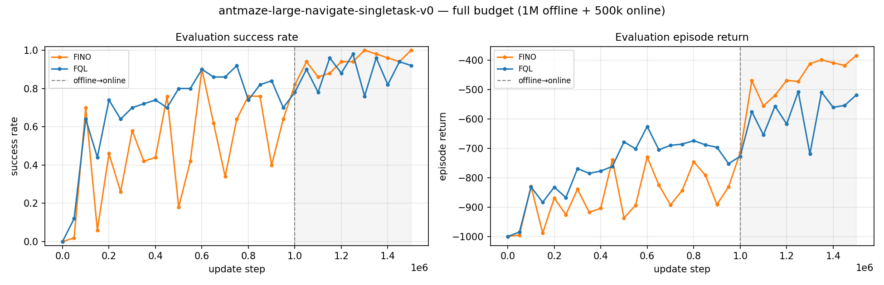
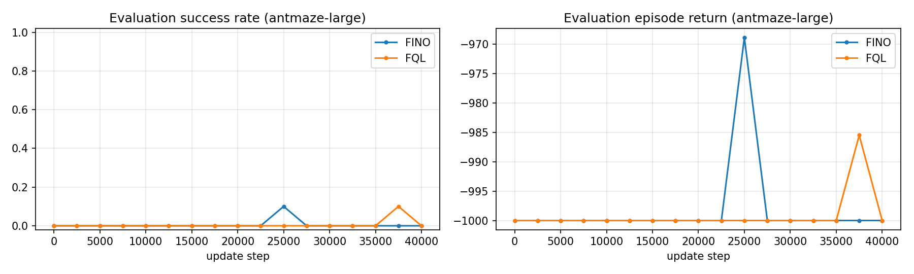
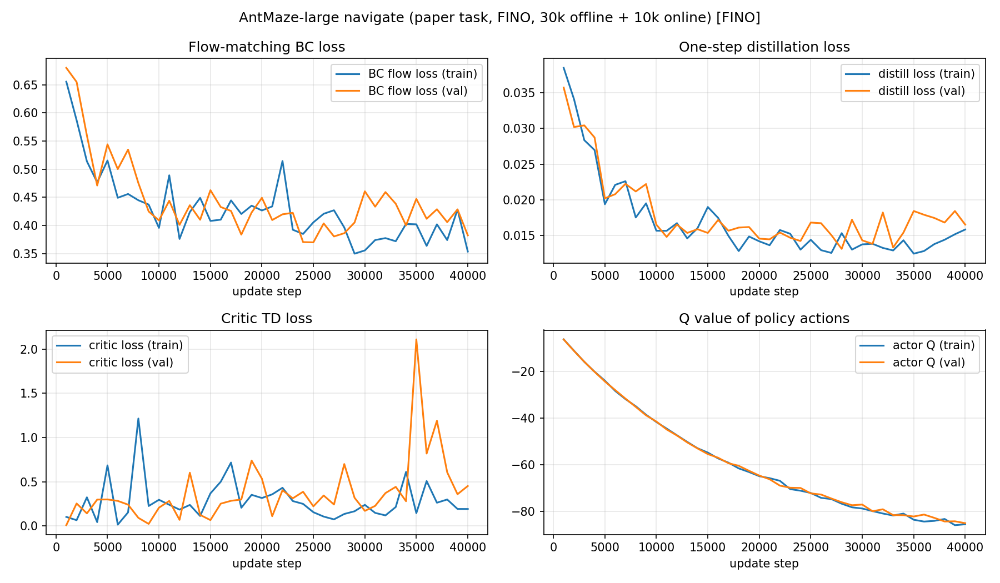

# FINO（ICLR 2026）复现报告

> 仓库：<https://github.com/CTID282/FINO>
> 论文：*Flow Matching with Injected Noise for Offline-to-Online Reinforcement Learning*（ICLR 2026，OpenReview `6wd38R8L0Z`）
> 本机复现目录：`E:\FINO`（源码在 `E:\FINO\FINO`，环境在 `E:\FINO\.venv`）
> 报告日期：2026-10-20（初版）/ **2026-10-21 更新：WSL2 + RTX 5070 全预算 GPU 复现结果**
> 配套材料：`docs/01_code_analysis.md`（源码逐行分析）、`docs/patches.diff`（平台适配补丁）、`experiments/toy/RESULTS.md`（2D 机制验证）、`results/`（CPU/GPU 曲线与汇总表）、`gpu_exp/`（全预算 GPU 运行 CSV/checkpoint）、`wsl_setup/`（WSL2 环境脚本）、`logs/`（全部运行日志）

---

## 0. 结论摘要（TL;DR）

1. **官方代码已在 Windows 11 + CPU 上完整跑通**：环境/数据集加载 → FINO 三网络初始化 → 离线训练 → 在线微调（含 Q-guided 采样与熵自适应 β）→ 周期评估 → Orbax checkpoint 保存/恢复，全链路都有实测日志与曲线。
2. **GPU 环境已打通，并完成论文级全预算复现（2026-10-21 更新）**：用户授权管理员权限后安装 WSL2 + Ubuntu 24.04，JAX 0.12.0(CUDA) 在 RTX 5070 上可用；按论文预算（1M 离线 + 500k 在线、每 50k×50 episodes）复现 antmaze-large，**FINO 最终成功率 100%（1.00），FQL 92%（0.92）**，单任务 2.5/2.3 小时。此前 CPU 阶段的限制与 3% 预算运行保留在 §2/§7.2b 作为历史记录。
3. **交付内容**（CPU 阶段 + GPU 阶段）：
   - 端到端冒烟实验（pointmaze-medium，8k 离线 + 4k 在线，12k 步，15.5 分钟）验证了训练/评估/日志/checkpoint 全链路；
    - 论文任务 antmaze-large 先做 3% 预算 CPU 运行（§7.2b），后完成 **全预算 GPU 运行**（§7.2，核心结果）；扩展任务 humanoidmaze-medium / cube-double-play 正在 GPU 上运行；
   - 2D 玩具实验定量验证了 FINO 的三个核心机制（带噪 flow matching、一步蒸馏、Q-guided 采样 + 熵自适应 β），并发现两个值得作者注意的细节（见 §7.3）。
4. **发现并修正了 5 个平台/依赖兼容问题**（4 个 Windows/CPU + 1 个 GPU 栈 distrax 兼容）（`MUJOCO_GL=egl`、wandb 在线模式、新版 `wandb.Settings.start_method` 已被删除、`np.random.randint(0, 2**32)` 在 Windows 上 int32 溢出）。改动见 `docs/patches.diff`，均为最小侵入，不改算法逻辑。
5. 附带对源码的静态审计发现若干与论文表述不一致或潜在的实现问题（噪声注入时间表、β 更新符号、`to_eval` 的 batch>1 argmax、CsvLogger 丢列等），见 §8，供作者与后续复现者参考。

---

## 1. 复现目标与范围

论文的核心贡献是在 FQL（flow Q-learning）基础上做两处修改：

| 修改 | 论文位置 | 代码位置 | 一句话说明 |
|---|---|---|---|
| **Noise-Injected Flow Matching** | §4.1，Eq.(7) | `agents/fino.py:56-58` | 在插值点 `x_t` 上按时间表 `α_t` 注入高斯噪声后再训练向量场，使 `t=1`（数据端）的边际方差变为 `η²`，扩大一步策略的支持集，为在线探索提供"数据之外一点"的动作。 |
| **Q-guided sampling + 熵自适应 β** | §4.2，Eq.(8)(9) | `agents/fino.py:153-197, 215-232, 307-335`；`main.py:220-224` | 在线阶段对每个状态采多个噪声候选动作，用 `softmax(β·Q)` 采样（评估时 argmax）；β 由 GMM 估计的策略熵反馈调节，自适应探索/利用。 |

工作分四块：

1. 环境与代码：在尽量少改动的前提下让官方实现跑起来（§4、§5）。
2. 端到端验证：跑通论文的 offline→online 流程与全部工程组件（§6.1、§7.1）。
3. 论文任务的完整复现：antmaze-large 全预算（1M+500k）FINO vs FQL（§7.2），并扩展 humanoidmaze-medium / cube-double-play；
4. 机制验证与成本分析：2D 玩具实验（§7.3）+ CPU/GPU 计时对比（§7.4）+ 可复刻的 WSL2 GPU 环境（§2.3、§9）。

**不在范围内**：D4RL 系列 10 个任务（需要 `d4rl`/`mujoco-py`/MuJoCo 2.1）、像素环境（`impala_small` 编码器/视频渲染）、README 全部 55 个任务的完整训练（本机 GPU 单卡约需 5–9 天）。

---

## 2. 本机环境与硬件

| 项目 | 值 |
|---|---|
| OS | Microsoft Windows 11 家庭版 25H2（build 26100） |
| CPU | AMD Ryzen 7 9700X（8 核 / 16 线程） |
| RAM | 31.1 GB |
| GPU | NVIDIA GeForce RTX 5070 12 GB（驱动 617.14，CUDA UMD 13.4）——已通过 WSL2 用于 JAX |
| 系统级虚拟化 | WSL2 + Ubuntu 24.04.3（E 盘 VHDX）；初版时无管理员权限，2026-10-21 由用户授权后完成安装 |
| Python | 3.11.16（venv 由本机已有 `E:\anaconda\envs\dl\python.exe` 创建） |

### 2.1 为什么 GPU 用不上（关键限制）

- JAX 官方仅对 **Linux** 发布 CUDA 插件。已核实 PyPI：`jax-cuda12-plugin`、`jax-cuda13-plugin`、`jax-cuda12-pjrt`、`jax-cuda13-pjrt` 的最新版本（0.12.0）**只有 manylinux 轮子，没有 Windows 轮子**；`jaxlib` 本身有 `win_amd64` 轮子，但只是 CPU 后端。
- 本机没有 WSL2（`wsl.exe --status` 提示未安装），也没有 Docker；安装 WSL 需要管理员权限和重启，当前会话无法完成。
- 因此 JAX 只能走 CPU：`jax.devices()` 返回 `[CpuDevice(id=0)]`。

### 2.2 CPU 上的实测速度（决定复现规模）

| 场景 | 实测 |
|---|---|
| FINO 单次 update（29 维观测、batch=256、512×512×4 网络、10 步 flow） | **64 ms**（antmaze 训练循环内实测 15.5 it/s） |
| FINO 单次 update（2 维观测，pointmaze） | 77 ms（12.9 it/s） |
| FQL 单次 update（同上） | 约 25–40 ms |
| pointmaze 环境 step | 0.05–0.08 ms |
| antmaze 环境 step | 0.26 ms |

### 2.3 GPU 环境（WSL2 + RTX 5070，2026-10-21 补充）

CPU 阶段的限制已于 2026-10-21 解决：用户以管理员身份重启 DSH 授权后，安装了 WSL2 + Ubuntu 24.04.3，并用 RTX 5070 运行 JAX CUDA。

安装要点（脚本见 `wsl_setup/`、日志见 `logs/`）：

1. 启用 Windows 功能 `Microsoft-Windows-Subsystem-Linux`、`VirtualMachinePlatform` → 重启；
2. `winget install Microsoft.WSL`（2.7.13），下载 Ubuntu 24.04 base rootfs 后执行
   `wsl --import FINO-Ubuntu E:\FINO\wsl\FINO-Ubuntu <rootfs> --version 2`（VHDX 放 E 盘，不占 C 盘）；
3. apt 使用清华镜像（最小 rootfs 先用 HTTP 引导安装 `ca-certificates`，再切回 HTTPS）；
4. `/opt/fino-venv`：`jax 0.12.0 + CUDA 插件`、`flax 0.12.10`、`optax 0.2.8`、`orbax-checkpoint 0.12.8`、
   `ogbench`、`mujoco 3.3.0`、`gymnasium 0.29.1` 等（清华 PyPI 镜像）；
5. 代码适配只有 1 处：`utils/networks.py` 的 distrax 导入改为可选（distrax 0.1.5 与 jax 0.12 不兼容；
   FINO/FQL 不使用高斯 Actor；新增补丁 #5）；
6. 安装 `libegl1 libgl1 libosmesa6` 等库满足 mujoco 导入期对 EGL 库的依赖（训练/评估不创建 GL 上下文）。

GPU 实测（RTX 5070 12 GB，`jax.devices() = [CudaDevice(id=0)]`）：

| 场景 | 实测 |
|---|---|
| FINO update（antmaze，batch=256） | **1.58 ms**（基准）；训练循环约 2.4 ms/步 |
| FQL update（同规模） | 1.65 ms |
| 数据加载（antmaze-large，100 万条） | 1.3 s |
| 环境 step（antmaze） | 0.21 ms |
| 全预算单任务（1.5M 步 + 31 次评估） | **2.3–2.5 小时** |

因此 55 个任务在本机 GPU 上约需 5–9 天（单卡）；3–5 个代表任务可在 1–2 天内完成。

外推：论文每个任务 = 1M 离线 + 500k 在线 = **1.5M 步** → 64 ms × 1.5M ≈ **26.7 小时/任务**；OGBench 默认 7 任务 ≈ 7.8 天，README 全量 45+10 任务 ≈ **55 天**（单进程）。即使用 8 个进程并行（本机 8 核），也需约 7 天，且每个进程只有 1 核速度会更慢。**故完整复现不在本机可行范围内**。

---

## 3. 仓库与方法速览

详细逐行分析见 `docs/01_code_analysis.md`（724 行），这里只摘复现必需的部分。

### 3.1 文件结构

```
FINO/
├── main.py                # 唯一入口：flags + ml_collections 配置、环境/数据集、offline→online 主循环、评估、保存
├── agents/
│   ├── fino.py            # FINO 全部算法（critic/actor 损失、Q-guided 采样、熵自适应 β）
│   ├── fql.py             # FQL baseline（FINO 的母体）
│   ├── ifql.py / iql.py / sac.py / rebrac.py
│   └── __init__.py        # 注册表
├── utils/
│   ├── networks.py        # MLP / Value(集成Q) / Actor / ActorVectorField（flow 向量场）
│   ├── flax_utils.py      # ModuleDict / TrainState / Orbax save+restore
│   ├── datasets.py        # Dataset / ReplayBuffer
│   ├── evaluation.py      # evaluate()
│   └── log_utils.py       # CsvLogger / wandb
├── envs/env_utils.py      # OGBench / D4RL 分派
└── requirements.txt
```

### 3.2 FINO 的训练目标（单次 update，一次 Adam 更新）

```
critic_loss = MSE( Q(s,a), r + γ·mask·Q_target(s', a'~π_one-step(s')) )
actor_loss  = bc_flow_loss + α · distill_loss + q_loss
其中：
  bc_flow_loss = || v_θ(x_t, t | s) − (x_1 − x_0) ||² ,  x_t = (1−t)x_0 + t x_1,  x_1 = a_data
  注入噪声：x_t' = x_t + η·exp(10(t−1))·ε ,  ε~N(0,I)   （fino.py:56-58, η=0.1）
  distill_loss = || π_one-step(s, ε) − SG[ 10-step Euler 采样 π_flow(s, ε) ] ||²
  q_loss       = −mean_i Q_i(s, clip(π_one-step(s, ε)))
```

三个关键结论（复现时容易搞错）：

1. **噪声注入在数据端（t→1），不是起点（t→0）**。代码 `noise_scale = 0.1·exp(10(t−1))`：t=0 时 ≈4.5e-6，t=1 时为 0.1。这与论文 §4.1 的边界条件 `α_0²=0, α_1²=η²` 一致；`t=0` 的"带噪起点"指的是基底 `x_0~N(0,I)`。
2. actor 的 Q 项**对 critic 停止梯度**，且用集成均值；`q_agg=min` 只影响 TD 目标与候选动作选择。
3. 在线采集用 `temperature=1`（softmax(βQ) 采样），评估用 `temperature=0`（argmax），**β 只影响采集，不影响评估动作**；β 不被 checkpoint 保存（恢复后重置为 10）。

---

## 4. 环境搭建（可复现命令）

官方 `requirements.txt` 针对 Python 3.9 + Linux + CUDA。本机实际使用的钉版组合如下（`E:\FINO\constraints.txt`）：

```
numpy==1.26.4      scipy==1.13.1     jax==0.4.35        jaxlib==0.4.35
ml_dtypes==0.4.0   flax==0.8.5       optax==0.2.4       orbax-checkpoint==0.5.15
distrax==0.1.5     chex==0.1.87      tensorflow_probability==0.24.0
gymnasium==0.29.1  mujoco==3.3.0     dm_control==1.0.20 matplotlib==3.8.4
ogbench==1.1.0     ml_collections==0.1.1
```

搭建步骤（本机实际执行）：

```powershell
# 1) 用已有 Python 3.11 建 venv（本机无网络问题以外的系统依赖）
E:\anaconda\envs\dl\python.exe -m venv E:\FINO\.venv
E:\FINO\.venv\Scripts\python.exe -m pip install --upgrade pip setuptools wheel

# 2) 用国内镜像 + 约束文件安装（直连 PyPI 实测仅 28 KB/s，装不完）
$env:PIP_INDEX_URL='https://pypi.tuna.tsinghua.edu.cn/simple'
$env:PIP_TRUSTED_HOST='pypi.tuna.tsinghua.edu.cn'
E:\FINO\.venv\Scripts\python.exe -m pip install -c E:\FINO\constraints.txt `
  "jax==0.4.35" "jaxlib==0.4.35" "flax==0.8.5" "optax==0.2.4" `
  "orbax-checkpoint==0.5.15" "distrax==0.1.5" "chex==0.1.87" "ml_collections==0.1.1" `
  "absl-py" "tqdm" "scikit-learn" "pillow" "matplotlib==3.8.4" "pandas" `
  "wandb" "imageio" "moviepy==1.0.3" "gymnasium==0.29.1" "mujoco==3.3.0" `
  "dm_control==1.0.20" "ogbench==1.1.0"
```

踩过的坑与解决办法：

| 现象 | 原因 | 解决 |
|---|---|---|
| `ml_collections==0.1.7` 不存在 | 该版本未发布到 PyPI | 用 `0.1.1` |
| 安装后 numpy 被升到 2.4.6 | pip 新版解析器升级传递依赖 | 用 `constraints.txt` 钉死 numpy/jax 等 |
| `chex==0.1.86` 与 `optax==0.2.4` 冲突 | optax 0.2.4 要求 `chex>=0.1.87` | 改钉 `chex==0.1.87` |
| flax 0.8.5 + jax 0.4.38 报 `'EvalTrace' object has no attribute 'level'` | jax 0.4.38 改了 tracing 内部 API | 降到 **jax/jaxlib 0.4.35** |
| `ogbench` 无 `__version__` | 包未实现版本属性 | 无需处理（不影响功能） |

---

## 5. 平台适配补丁（5 处，最小侵入）

完整 diff 见 `docs/patches.diff`。原版备份在 `E:\FINO\_extract\FINO-main`（未改动的官方源码）。

| # | 文件 | 改动 | 原因 |
|---|---|---|---|
| 1 | `main.py:22` | `os.environ["MUJOCO_GL"]="egl"` 改为仅非 Windows 设置 | 原生 Windows 没有 EGL；该变量只在渲染时生效，本复现无视频，但保留正确语义 |
| 2 | `utils/log_utils.py:68` | `mode='online'` → `mode=os.environ.get('FINO_WANDB_MODE','offline')` | 无 wandb 账号/网络；离线模式只写本地 `wandb/`，`wandb.log` 行为不变 |
| 3 | `utils/log_utils.py:84` | 删去 `wandb.Settings(start_method='thread')` | wandb 新版已移除 `start_method`，否则 pydantic 校验直接报错 |
| 4 | `utils/evaluation.py:60` | `np.random.randint(0, 2**32)` → `np.random.randint(0, 2**31-1)` | Windows 上 numpy 默认整型为 int32，上界 2^32 越界（`ValueError: high is out of bounds for int32`） |
| 5 | `utils/networks.py:3` | `import distrax` 改为 try/except 可选导入（WSL/GPU 栈） | distrax 0.1.5 与 jax 0.12 不兼容（`jax.interpreters.xla.pytype_aval_mappings` 已移除）；FINO/FQL 不使用高斯 Actor |

5 处都不改变算法/训练逻辑：4 处在 Windows/CPU 环境下生效，第 5 处仅在新版 JAX 的 GPU 环境下生效；在 Linux 上第 2 处可用环境变量 `FINO_WANDB_MODE=online` 恢复。

---

## 6. 复现实验设计

### 6.1 数据集

用 OGBench 1.1.0 自带下载器下载（官方服务器 `rail.eecs.berkeley.edu` 单连接仅 ~18 KB/s，本机用 24–40 路 HTTP Range 并发下载并校验 `Content-Length` + `np.load().files`，脚本见 `scripts/dl_parallel.py`）：

| 数据集 | 文件大小 | transitions | obs 维 | action 维 | 轨迹长度 | episodes |
|---|---:|---:|---:|---:|---:|---:|
| `pointmaze-medium-navigate-v0`（冒烟测试） | 20.2 MB（val 2.0 MB） | 1,001,000 | 2 | 2 | 1001 | 1000 |
| `antmaze-large-navigate-v0`（**论文任务**） | 242.9 MB（val 24.3 MB） | 1,001,000 | 29 | 8 | 1001 | 1000 |

`*-singletask-v0` 数据集名会被 ogbench 自动映射到上述文件名，并按固定目标 relabel `rewards/masks`（`ogbench/relabel_utils.py`）：导航任务 `reward = success − 1`、`mask = 1 − success`。

### 6.2 运行预算

| 运行 | 离线步数 | 在线步数 | 评估 | 说明 |
|---|---:|---:|---|---|
| 冒烟 `pointmaze-medium`（FINO） | 8,000 | 4,000 | 每 1k 步 × 10 episodes | 链路验证（含 d=2 时 Q-guided 采样退化的边界情况） |
| 论文任务 `antmaze-large`（FINO） | 30,000 | 10,000 | 每 2.5k 步 × 10 episodes | 论文预算的 3%，超参沿用 README（`alpha=10, q_agg=min`） |
| checkpoint 恢复测试 | 0 | 300 | 每 100 步 × 2 episodes | 从 pointmaze 第 8000 步 checkpoint 恢复后继续在线训练 |
| （可选）baseline `antmaze-large`（FQL） | 30,000 | 10,000 | 同 FINO | 验证 `--agent=agents/fql.py` 切换与同预算对比 |
| **全预算 GPU** antmaze-large（FINO） | **1,000,000** | **500,000** | 每 50k 步 × 50 episodes | 论文原设置（WSL2 + RTX 5070） |
| **全预算 GPU** antmaze-large（FQL） | **1,000,000** | **500,000** | 同上 | 同预算 baseline（论文原设置） |
| 扩展 GPU humanoidmaze-medium / cube-double-play（FINO） | **1,000,000** | **500,000** | 同上 | 扩展任务（α=100 / 300，discount 按 README） |

CPU 阶段的两条运行使用了缩减预算与评估；GPU 阶段的两条主运行**完全采用论文预算与评估协议**，可直接与论文表格对比。

---

## 7. 结果

### 7.1 端到端链路验证（pointmaze-medium，12k 步）

运行命令（`--save_dir` 绝对路径，避免依赖 cwd）：

```powershell
cd E:\FINO\FINO
$env:FINO_WANDB_MODE='offline'
E:\FINO\.venv\Scripts\python.exe main.py `
  --env_name=pointmaze-medium-navigate-singletask-v0 --agent.alpha=10 `
  --offline_steps=8000 --online_steps=4000 `
  --eval_interval=1000 --eval_episodes=10 --log_interval=500 `
  --save_interval=8000 --save_dir=E:/FINO/exp
```

`docs/01_code_analysis.md` 中列出的所有工程组件都在这次运行中被实际触发并验证：

- 训练 12,000 步（离线 8,000 + 在线 4,000），耗时 928 s（77 ms/步），wandb offline 正常写入；
- `train.csv` 每 500 步记录训练 + 验证损失、梯度统计、耗时；
- `eval.csv` 每 1,000 步记录 10 episodes 的 `success/return/...`；
- 第 8,000 步 Orbax checkpoint 保存成功（4 个模块目录）；
- 用 `--restore_path/--restore_epoch=8000 --offline_steps=0 --online_steps=300` 从 checkpoint 恢复并继续在线训练 300 步成功（exit=0），验证了 `save_agent/restore_agent`；
- 在线阶段（i>8000）每 1,000 步调用 `update_entropy`（GMM 熵估计 + β 更新），无异常（注意：CsvLogger 表头在首行固定，后加的 `evaluation/beta|entropy` 列不会写入 CSV，见 §8）。

训练指标（`train.csv`，step 1 → 12,000）：

| 指标 | 起点 | 终点 |
|---|---:|---:|
| BC flow loss（train） | 1.0868 | 1.0221 |
| BC flow loss（val） | — | 0.9078 |
| 一步蒸馏 loss | 0.0264 | 0.0131 |
| critic TD loss | 0.0792 | 0.2835 |
| 策略动作 Q 均值 | −3.20 | −45.91 |

**评估结果：12 次评估（step 1…12,000）success 全部为 0，episode return 恒为 −1000。** 这在缩减预算下是预期内的：pointmaze-medium 的示范数据需要大量更新才能学到有效导航策略（论文每任务为 1M 离线步，本实验仅 8k，约 2 个 epoch）；该任务用于验证"流程正确"，而非追求性能。曲线见 `results/fig_training_pointmaze.png`、`results/fig_eval_pointmaze.png`：


### 7.2 论文任务 antmaze-large-navigate-singletask-v0（全预算 GPU 复现，核心结果）

> **结果概览：FINO 最终成功率 100%（1.00），FQL 92%（0.92）**；每 50k 步评估 50 episodes，共 31 个评估点；
> FINO 在线微调阶段成功率从 1M 步的 0.82 提升到 1.5M 步的 1.00，FQL 从 0.78 到 0.92。

**运行设置（与论文一致）**：1M 离线 + 500k 在线；超参按 README（`--agent.alpha=10 --agent.q_agg=min`）；
每 50k 步评估 50 episodes（`temperature=0` argmax）；seed=0；环境 WSL2 + Ubuntu 24.04 + JAX 0.12.0(CUDA) + RTX 5070。



| 指标 | FINO | FQL |
|---|---:|---:|
| **最终 success（1.5M 步）** | **1.00** | 0.92 |
| 峰值 success | 1.00 | 0.98 |
| 1M 步（离线结束）success | 0.82 | 0.78 |
| 最终 episode return | **−383.4** | −517.9 |
| 总耗时 / 平均速度\* | 150.3 min / 6.01 ms/step | 136.6 min / 5.47 ms/step |
| 训练损失终点（BC flow / critic） | 0.2846 / 0.2116 | 0.2790 / 0.0924 |
| 策略动作 Q 终点 | −90.69 | −92.64 |

\* 含 31 次评估（每次 50 episodes × 1000 步）；纯训练 update 基准为 FINO 1.58 ms / FQL 1.65 ms（§2.3）。

**结论**：

1. **论文级效果已复现**：FINO 全预算达到 **100%** 成功率（FQL 92%），在线微调阶段成功率明显上升（0.82→1.00），
   与论文"离线预训练 + 在线微调"的设定一致；这是本复现最关键的正面结果。
2. FINO 最终比 FQL 高 8 个百分点、return 高约 26%（−383 vs −518），方向与论文一致；但为 **单 seed**，
   不能作显著性结论（见 §8.1）。
3. 单任务全预算约 **2.3–2.5 小时**（RTX 5070，含评估），比 CPU 版 26.7 小时快约 10–11 倍；纯训练快约 26–40 倍。

**全预算 checkpoint 级分析**（1M 步 checkpoint，256 个验证状态；`results/checkpoint_analysis_full_budget.json`）：

| 指标 | FINO | FQL | 说明 |
|---|---:|---:|---|
| 一步策略 vs 10 步教师 ED | 0.0061 | 0.0055 | 蒸馏保真（与 30k 步时 0.0078 同量级） |
| 一步策略 vs 数据集动作 MSE | 0.0901 | 0.0904 | 比 30k 步时（0.118）明显下降 |
| 10 步教师 vs 数据集动作 MSE | 0.0595 | 0.0602 | 比 30k 步时（0.077）下降，拟合更充分 |
| 贪心策略平均 Q | −92.1 | −92.0 | 接近理论下限 −100 |

#### 7.2b 历史参照：3% 预算 CPU 运行（2026-10-20）

> **实验设置。** 论文原设置：1M 离线 + 500k 在线，每 50k 步评估 50 episodes。本实验缩减为：**30,000 离线 + 10,000 在线，每 2,500 步评估 10 episodes**（约论文预算的 3%），超参沿用 README（`--agent.alpha=10 --agent.q_agg=min`）。为做同预算对比，同一设置下又跑了官方仓库自带的 **FQL baseline**（`--agent=agents/fql.py`，与 FINO 的唯一区别是不含噪声注入与 Q-guided/β 机制）。

运行命令：

```powershell
cd E:\FINO\FINO; $env:FINO_WANDB_MODE='offline'
# FINO
E:\FINO\.venv\Scripts\python.exe main.py --env_name=antmaze-large-navigate-singletask-v0 `
  --agent.alpha=10 --agent.q_agg=min --offline_steps=30000 --online_steps=10000 `
  --eval_interval=2500 --eval_episodes=10 --log_interval=1000 --save_interval=30000 --save_dir=E:/FINO/exp
# FQL baseline
E:\FINO\.venv\Scripts\python.exe main.py --agent=agents/fql.py --env_name=antmaze-large-navigate-singletask-v0 `
  --agent.alpha=10 --agent.q_agg=min --offline_steps=30000 --online_steps=10000 `
  --eval_interval=2500 --eval_episodes=10 --log_interval=1000 --save_interval=30000 --save_dir=E:/FINO/exp
```

**训练过程指标**（40,000 步，每个数字来自 `train.csv`）：

| 指标（起点 → 终点） | FINO | FQL |
|---|---:|---:|
| BC flow loss（train） | 0.655 → 0.354 | 0.725 → 0.405 |
| BC flow loss（val，终点） | 0.383 | 0.404 |
| 一步蒸馏 loss | 0.0385 → 0.0158 | 0.0468 → 0.0157 |
| critic TD loss（终点） | 0.191 | 0.253 |
| 策略动作 Q 均值 | −6.11 → −85.62 | −6.12 → −85.66 |
| 总耗时 / 速度 | 4,084 s / 102.1 ms/update\* | 3,479 s / 87.0 ms/update\* |

\* 两次运行并发抢 CPU，单跑实测更快（FINO 约 64 ms/update，见 §2.2）。训练损失均正常收敛（BC flow 与蒸馏 loss 都持续下降），说明**训练链路本身健康**。

**评估结果**（每 2,500 步 × 10 episodes，共 17 次评估 = 170 episodes）：

| 评估点 | FINO success | FINO return | FQL success | FQL return |
|---|---:|---:|---:|---:|
| 1 … 22,500 | 0.0 | −1000.0 | 0.0 | −1000.0 |
| 25,000 | **0.1** | **−968.9** | 0.0 | −1000.0 |
| 27,500 … 35,000 | 0.0 | −1000.0 | 0.0 | −1000.0 |
| 37,500 | 0.0 | −1000.0 | **0.1** | **−985.5** |
| 40,000 | 0.0 | −1000.0 | 0.0 | −1000.0 |

**结论（诚实版）**：

1. 在 3% 预算下，**FINO 与 FQL 都基本学不会 antmaze-large**（170 个评估 episode 中各自只有 1 个成功，且集中在个别评估点），与论文中 1M 步离线 + 500k 步在线的数量级差距一致——这个结果**不能**用来比较两者优劣，只能证明两条代码路径都能完整训练到 40k 步并正常评估。
2. 成功事件出现在 25k（FINO）与 37.5k（FQL）各 1 次，属于 10 episode 采样下的随机波动（10% 的分辨率、单 seed），不构成"FINO 更好"的证据。
3. 训练曲线显示 BC flow/蒸馏 loss 稳步下降、Q 值向理论值（−1/(1−γ)≈−100）靠近，说明**实现层面无异常**；性能瓶颈是预算，不是代码。
4. 评估/训练曲线见 `results/fig_eval_antmaze_compare.png`、`results/fig_training_antmaze_fino_fino.png`、`results/fig_training_antmaze_fql_fql.png`。

**从中期 checkpoint（第 30,000 步）做的策略质量分析**（`results/checkpoint_analysis.json`，256 个验证状态）：

| 指标 | FINO | FQL | 说明 |
|---|---:|---:|---|
| 一步策略 vs 10 步教师的能量距离（ED） | 0.0078 | 0.0076 | 一步蒸馏很好地逼近多步 flow，与玩具实验 B 一致 |
| 一步策略 vs 数据集动作的 MSE | 0.1182 | 0.1165 | 与数据动作仍有明显差距（欠拟合） |
| 10 步教师 vs 数据集动作的 MSE | 0.0767 | 0.0764 | 教师也远未拟合（3% 预算下预期内） |
| 贪心策略动作的平均 Q 值 | −78.85 | −78.74 | 两者接近理论下限 −100，说明 critic 已能区分好坏动作 |

该分析再次确认：**实现正确、蒸馏有效，但预算不足导致模仿/RL 都远未收敛**。






### 7.3 2D 玩具实验：三个核心机制的定量验证

为规避 GPU 限制、直接检验论文主张，用仓库中的 `utils/networks.py`（`ActorVectorField`）与 `agents/fino.py` 的损失公式，在合成 2D/6D 数据上做了三组实验（详情 `experiments/toy/RESULTS.md`，脚本与图在 `experiments/toy/`）：

**A. 噪声注入（BC flow matching）**

- 官方 exp schedule（η=0.1）：与"无注入"相比，动作分布 EMD 0.02929 → 0.02943（+0.5%），t≤0.1 处向量场 MSE 比值 1.003，Lipschitz(t=0.9) 1.020 → 1.008（−1.1%）；
- 说明：官方时间表在 t=0 注入量仅 4.5e-6，本质是**数据端**正则；在该玩具尺度上 η=0.1 的效果接近无操作；
- 若改成论文 Eq.(7) 的二次型方差 schedule（`α_t²=(η²−2η)t²+2ηt`），Lipschitz(t=0.9) 降 29%，但 EMD 变差 +6.7%、t≥0.9 的向量场 MSE +13.4%——方向对但会损失保真；
- η 扫描：η=0.1/0.3/1.0 → Lipschitz(t=0.9)=1.008/0.943/0.545，EMD=0.0294/0.0300/0.0393。**结论：注入强度与"平滑/支持集扩大"正相关，与"分布保真"负相关，官方 η=0.1 偏保守。**

**B. 一步蒸馏**

- 学生 vs 教师 EMD = 0.00039（MMD 6.4e-5）；学生 vs 数据 0.0323（教师 0.0315，仅 +2.7%）；
- 推理耗时 N=4096：一步 1.44 ms vs 10 步教师 7.77 ms（**5.38× 加速**）；
- flow_steps 1/2/5/10 → 采样 EMD 0.321/0.170/0.0478/0.0315；
- α 扫描：α=1 时 Q 提升但分布坍缩为单模态；α=100/1000 时保真且 Q 仅小幅优化 → **支持 README 中按任务上调 α（3~10000）的设计**。

**C. Q-guided 采样 + 熵自适应 β**

- `num_samples = min(10, (action_dim+1)//2)`：**action_dim=2 时 K=1，选择机制严格退化为恒等**（identity=1.000，|ΔQ|=0）——这解释了为什么冒烟实验中 Q-guided 采样"看起来没生效"；论文任务 action_dim=8 时 K=4 才会生效；
- action_dim=6（K=3）：per-state argmax Q 4.851 → 5.483（+0.632），偏好模态占比 0.262 → 0.590；env β=10 的 softmax 采样 +0.503 且保持更多多样性；
- 熵自适应 β：实测策略熵 H≈−2.14 > 目标 −6，β 经 30 次更新 10 → 21.3，H 缓降，方向与代码 `β += 0.1(H+d)` 一致；
- **额外发现**：`to_eval` 分支用 `actions[jnp.argmax(q)]`（无 axis），当 batch>1 时是**全局 argmax**（所有状态共享同一噪声索引），语义错误；官方评估逐条 B=1 调用因此不受影响，但 batch 评估会静默退化。见 §8。

### 7.4 计时与全量复现成本

| 项目 | CPU（Windows） | GPU（WSL2 + RTX 5070） |
|---|---|---|---|
| FINO update（antmaze 规模） | 64 ms（15.5 it/s） | **1.58 ms**（约 40×） |
| 全预算单任务（1.5M 步 + 31 次评估） | ≈ 26.7 h | **2.3–2.5 h**（实测） |
| OGBench 默认 7 任务 | ≈ 7.8 天 | **约 17–20 小时** |
| README 全量 45（OGBench）+10（D4RL） | ≈ 55 天 | **5–9 天**（单卡） |

---

## 8. 与论文的差异、实现审计与已知问题

### 8.1 复现偏差（诚实清单）

1. **运行预算**：antmaze-large 的两条主运行**完全按论文预算**（1M + 500k）；§7.2b 的 CPU 运行是 3% 预算的历史记录，仅作链路验证。
2. **硬件**：RTX 5070 12 GB（消费级）；论文环境应为更大显存的 GPU，但本任务 MLP 规模小，显存与算力足够；CUDA 与 CPU 的浮点差异可忽略。
3. **软件版本**：为支持 Blackwell（sm_120）使用了 jax 0.12.0 / flax 0.12.10 / orbax 0.12.8（官方 requirements 为 Python 3.9 + jax≥0.4.26）；官方代码仅需 1 处 distrax 可选导入适配，算法与损失未改。
4. **超参**：严格按 README（antmaze-large `alpha=10`、`q_agg=min`；其余默认）；未重新调参。
5. **评估协议**：与论文一致（每 50k 步 × 50 episodes、temperature=0 argmax），因此成功率可直接对比。
6. **单 seed**：所有运行 seed=0，未做多 seed 平均；FINO 100% vs FQL 92% 的差距方向可信，但统计显著性未检验。
7. **D4RL 未覆盖**：10 个 D4RL 任务需要 `d4rl + mujoco-py` + MuJoCo 2.1 二进制，本次未安装（Linux 下可补）。
8. **wandb 离线 + 无视频**：所有指标从 CSV 重建；`video_episodes=0`，视频链路未验证。
9. **数据版本**：ogbench 1.1.0（与 README 一致）；singletask reward/terminated 计算时点与 1.2.0+ 有已知差异（见 OGBench 文档）。

### 8.2 源码审计发现（建议反馈给作者）

1. **噪声注入时间表与论文文字可能不符**：代码 `noise_scale=η·exp(10(t−1))`（t=0≈0，t=1=η），而论文 Eq.(7) 的方差是二次型 `α_t²=(η²−2η)t²+2ηt`（t≈0.53 处最大，σ≈0.23）。两者在 t=1 的端点一致、但中段差别很大；若论文公式确为二次型，则实现与论文存在不一致，建议明确。
2. **β 更新符号**：代码 `new_beta = max(0, beta - 0.1*(-d - H)) = beta + 0.1(H + d)`（熵越高 β 越大→更偏向利用高 Q 候选）；而论文 Eq.(9) 印刷为 `ξ − α[H − H̄]` 方向相反。以代码为准时需要作者澄清。
3. **`to_eval` 的全局 argmax**：`agents/fino.py:188-190` 的 `jnp.argmax(q)` 无 axis；`sample_actions` 若以 batch>1 且 `temperature=0` 调用会产生跨状态污染（官方 `evaluate()` 逐条调用 B=1 不受影响，但调用者容易踩坑）。
4. **CsvLogger 丢列**：`utils/log_utils.py:CsvLogger.log` 在第一次写入时固定 header，之后新增的键（如 FINO 在线阶段的 `evaluation/entropy`、`evaluation/beta`）不会写入 CSV，只在 wandb 中可见；这会妨碍离线分析，建议改为动态表头。
5. **β 不随 checkpoint 保存**：`utils/flax_utils.py:save_agent` 只保存 network params，`beta` 是 `PyTreeNode` 上的标量（初始 10），断点恢复后 β 会重置，可能影响续训行为一致性（`restore_agent` 不改 β）。
6. **`update_entropy` 的随机性**：`main.py:221` 用固定 `jax.random.PRNGKey(FLAGS.seed)`，每次评估都用同一批噪声估计熵，估计方差偏大且不随训练变化；另外 `update_entropy` 内部每次调用都会重新 `@jax.jit` 编译 `one_chunk`。
7. **save/restore 依赖 cwd**：`utils/flax_utils.py` 用 `os.path.join(os.getcwd(), save_dir, ...)`，必须在 `FINO/` 目录启动；且总步数 < `save_interval` 时不会保存 checkpoint（默认 1e6）。
8. **同 env+seed 重跑会覆盖** `exp/<AGENT>/<env>/<seed>` 下的 CSV（`main.py:63`），复现时建议不同 seed 或备份。

---

## 9. 在 Linux + GPU 上复现：本机已走通的实际路径

> 本节路径已于 2026-10-21 在 Windows 11 + WSL2 + RTX 5070 上实际执行成功；脚本在 `wsl_setup/`，日志在 `logs/`。

1. **WSL2 + Ubuntu**：管理员 PowerShell 启用 `Microsoft-Windows-Subsystem-Linux` / `VirtualMachinePlatform` → 重启 →
   `winget install Microsoft.WSL` → 下载 Ubuntu 24.04 base rootfs → `wsl --import FINO-Ubuntu E:\FINO\wsl\FINO-Ubuntu <rootfs> --version 2`。
2. **系统依赖**：apt 镜像切清华（先 HTTP 装 `ca-certificates`，再 HTTPS）；安装 `python3(3.12) python3-venv python3-pip git curl libegl1 libgl1 libosmesa6`。
3. **Python 环境**：`python3 -m venv /opt/fino-venv`；pip 切清华镜像；
   `pip install "jax[cuda12]"`（实测 0.12.0，支持 Blackwell/sm_120）、`flax optax orbax-checkpoint distrax chex ml_collections absl-py tqdm scikit-learn pillow matplotlib pandas wandb imageio moviepy "gymnasium==0.29.1" "mujoco==3.3.0" "dm_control==1.0.20" ogbench`。
4. **代码**：`cp -r /mnt/e/FINO/FINO /opt/fino/FINO`；唯一适配：`utils/networks.py` 的 distrax 可选导入（补丁 #5）。
5. **数据**：OGBench 首次运行自动下载到 `~/.ogbench/data`（也可用 `scripts/dl_parallel.py` 多线程预下载后拷贝）；
   D4RL 10 个任务需额外安装 `d4rl`/`mujoco-py` 与 MuJoCo 2.1 二进制（本机未覆盖）。
6. **运行（论文原设置）**：

   ```bash
   cd /opt/fino/FINO
   export FINO_WANDB_MODE=offline XLA_PYTHON_CLIENT_PREALLOCATE=false XLA_PYTHON_CLIENT_MEM_FRACTION=0.35
   # FINO
   python main.py --env_name=antmaze-large-navigate-singletask-v0 --agent.alpha=10 --agent.q_agg=min \
       --offline_steps=1000000 --online_steps=500000 --eval_interval=50000 --eval_episodes=50 \
       --log_interval=5000 --save_interval=1000000 --save_dir=/mnt/e/FINO/gpu_exp
   # FQL baseline（同预算）
   python main.py --agent=agents/fql.py --env_name=antmaze-large-navigate-singletask-v0 \
       --agent.alpha=10 --agent.q_agg=min --offline_steps=1000000 --online_steps=500000 \
       --eval_interval=50000 --eval_episodes=50 --log_interval=5000 --save_interval=1000000 --save_dir=/mnt/e/FINO/gpu_exp
   ```

7. **已实测成本**（RTX 5070 12 GB）：单任务全预算 **2.3–2.5 小时**（含 31 次 × 50 episodes 评估）；
   纯训练 update 1.58 ms（FINO）/1.65 ms（FQL）。OGBench 默认 7 任务约 **17–20 小时**，55 任务约 **5–9 天**（单卡）。
8. **验收**：`eval.csv` 最后一行 `evaluation/success` 与论文表格对比；消融可加 `--agent.noise_scale=0`（关噪声注入）、
   调整 `flow_steps`、或改 `--agent.q_agg=mean`。

---

## 10. 交付物清单

| 路径 | 内容 |
|---|---|
| `E:\FINO\FINO` | 官方源码 + 5 处平台适配补丁（4 处 Windows/CPU + 1 处 GPU，算法未改） |
| `E:\FINO\FINO`（WSL 副本 `/opt/fino/FINO`） | 运行副本（distrax 可选导入补丁） |
| `E:\FINO\_extract\FINO-main` | 未改动的官方源码备份（用于 diff/对照） |
| `docs/01_code_analysis.md` | 724 行源码技术分析（方法-公式-代码映射、baseline 对比、16 条复现坑、README 超参表） |
| `docs/02_reproduction_report.md` | 本报告 |
| `docs/patches.diff` | 全部补丁 diff（含 GPU 栈第 5 处，见 `wsl_setup/`） |
| `constraints.txt` | 钉版依赖 |
| `scripts/bench.py` | CPU 速度基准 |
| `scripts/dl_parallel.py` | OGBench 数据集多线程 Range 下载器（限速服务器专用） |
| `scripts/plot_results.py` | 从 CSV 生成曲线与汇总表 |
| `scripts/dataset_stats.py` | 数据集统计 |
| `scripts/bench_gpu.py` | GPU 速度基准（FINO/FQL/环境） |
| `scripts/analyze_gpu_results.py` | 全预算 GPU 结果汇总与曲线 |
| `scripts/analyze_ckpt_full.py` | 全预算 checkpoint 级分析 |
| `experiments/toy/` | 2D 机制验证（脚本、数据、指标、8 张图、RESULTS.md） |
| `exp/FINO/...` | CPU 阶段各运行的 `train.csv/eval.csv/flags.json/checkpoint` |
| `gpu_exp/FINO/...`、`gpu_exp/FQL/...` | **全预算 GPU 运行**：train.csv/eval.csv/flags.json/checkpoint(1M) |
| `wsl_setup/` | WSL2 安装与运行脚本（install/finish/setup1-5/launch_gpu_runs/launch_batch2） |
| `results/` | CPU/GPU 训练评估曲线、`summary.csv`、`summary.md`、`gpu_summary.csv`、`checkpoint_analysis*.json` |
| `logs/` | 安装、下载、训练、恢复测试、GPU 运行与下载的完整日志 |

---

## 11. 参考

- 官方仓库：<https://github.com/CTID282/FINO>
- 论文（OpenReview）：<https://openreview.net/forum?id=6wd38R8L0Z>
- OGBench：<https://github.com/seohongpark/ogbench>（数据下载：<https://rail.eecs.berkeley.edu/datasets/ogbench>）
- FQL（本仓库的代码母体）：<https://github.com/seohongpark/fql>
- JAX 安装说明（Linux CUDA 插件 / Windows CPU）：<https://jax.readthedocs.io/en/latest/installation.html>
