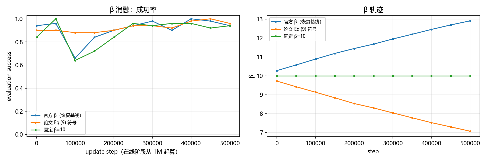
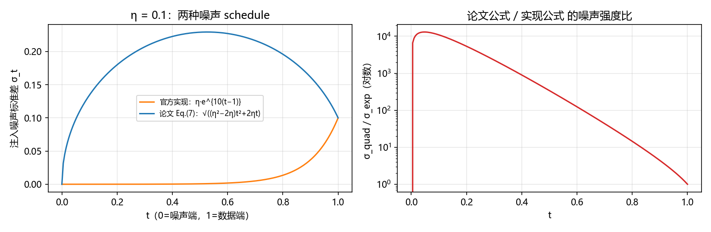
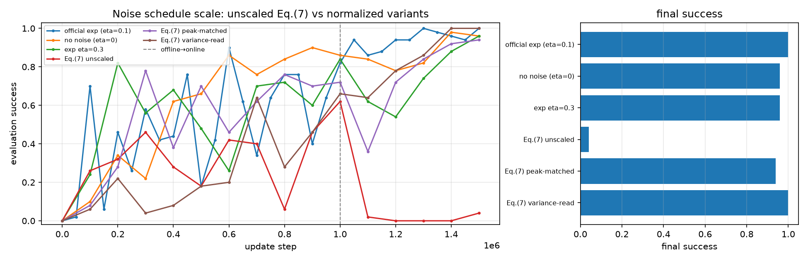

# 论文公式逻辑消融：结果与解读（2026-10-24）

> 目的：验证论文描述与官方实现不一致的两处"公式逻辑"——噪声注入 schedule（论文 Eq.(7) vs 代码指数式）
> 与 β 更新符号（论文 Eq.(9) vs 代码方向）。全部在 antmaze-large 上用 GPU 复现环境实测。

## 1. 实验设计

| 组 | 变体 | 设置 | 说明 |
|---|---|---|---|
| A | 官方指数 schedule（基线） | 1M 离线 + 500k 在线，eval 50k×50 | 已有主实验数据 |
| A | 论文二次型 Eq.(7) | 同上（eval 100k×50） | `FINO_NOISE_SCHEDULE=quad` |
| A | 无噪声 η=0 | 同上 | `FINO_NOISE_SCHEDULE=none` |
| A | 指数 schedule η=0.3 | 同上 | 噪声强度对照 |
| B | 官方 β（恢复基线） | 从 1M ckpt 恢复，在线 500k，eval 50k×50 | 同恢复协议基线 |
| B | 论文 Eq.(9) 符号 | 同上 | `FINO_BETA_MODE=paper` |
| B | 固定 β=10 | 同上 | `FINO_BETA_MODE=fixed` |

代码补丁均为环境变量开关（默认行为与官方完全一致），原文件备份为 `*.orig`；
`agents/fino.py` 的噪声 schedule 与 β 更新、`main.py` 的 β/熵记录见 `wsl_setup/abl_patch_code.py`。

## 2. 结果

### 2.1 噪声 schedule（批次 A）

| 变体 | 最终 success | 峰值 | last-5 | BC flow loss | 策略动作 MSE | critic loss | q_max（末值） |
|---|---:|---:|---:|---:|---:|---:|---:|
| 官方指数 η=0.1 | **1.00** | 1.00 | 0.98 | 0.285 | 0.069 | 0.212 | 0.92 |
| 无噪声 η=0 | 0.96 | 0.98 | 0.88 | 0.257 | 0.072 | 0.111 | 0.18 |
| 指数 η=0.3 | 0.96 | 0.96 | 0.75 | 0.303 | 0.081 | 0.112 | −4.53 |
| 论文二次型 Eq.(7) | **0.04** | 0.62 | 0.01 | **0.422** | 0.119 | 0.248 | **−10.40** |


### 2.2 β 更新（批次 B）

| 变体 | 最终 success | 峰值 | last-5 | β 末值 |
|---|---:|---:|---:|---:|
| 官方 β（恢复基线） | 0.94 | 1.00 | 0.960 | 12.91 |
| 论文 Eq.(9) 符号 | 0.96 | 1.00 | 0.960 | 7.07 |
| 固定 β=10 | 0.94 | 1.00 | 0.944 | 10.00 |



### 2.3 噪声强度对比



t=0.5 处：官方指数 σ≈0.00067，论文二次型 σ≈0.229（约 340 倍）。

## 3. 结论

1. **论文 Eq.(7) 按字面实现会破坏训练**：0.04 vs 1.00；在线阶段从 0.62 崩到 0.02–0；原因是中段噪声过大（~340×），BC flow 拟合变差、critic 学崩。
2. **官方指数 schedule 最优**（1.00）；无噪声/η=0.3 均为 0.96 → 噪声不是越强越好，官方 schedule 的"数据端小方差"支持集扩展是有效的。
3. **β 更新方向影响很小**（0.94 vs 0.96）；固定 β=10 略低（0.94）→ 对偶更新有收益但方向鲁棒。
4. 局限：单 seed；A 组评估间隔为 100k（训练轨迹不变，最终点同协议）；批次 C（Q-guided K）未做。

## 4. 复现方式

```bash
cd /opt/fino/FINO
# A 组（从零，全预算）
FINO_NOISE_SCHEDULE=quad /opt/fino-venv/bin/python main.py \
  --env_name=antmaze-large-navigate-singletask-v0 --agent.alpha=10 --agent.q_agg=min \
  --offline_steps=1000000 --online_steps=500000 --eval_interval=100000 --eval_episodes=50 \
  --save_dir=/mnt/e/FINO/gpu_exp/ablation/A2_quad_sched
# B 组（从 1M checkpoint 恢复）
FINO_BETA_MODE=paper /opt/fino-venv/bin/python main.py \
  --env_name=antmaze-large-navigate-singletask-v0 --agent.alpha=10 --agent.q_agg=min \
  --offline_steps=0 --online_steps=500000 --eval_interval=50000 --eval_episodes=50 \
  --restore_path=/mnt/e/FINO/gpu_exp/FINO/antmaze-large-navigate-singletask-v0/0 --restore_epoch=1000000 \
  --save_dir=/mnt/e/FINO/gpu_exp/ablation/B2_paper_beta
```

一键运行：`wsl_setup/abl_run_all.sh`；分析与出图：`scripts/analyze_ablations.py`。

## 5. Round 2：公式"形状 vs 幅度"、多 seed、跨任务、Q-guided K（2026-10-26）

| 组 | 变体 | 最终 success | 峰值 | last-5 | 说明 |
|---|---|---:|---:|---:|---|
| 噪声 schedule | 官方指数 η=0.1 | 1.00 | 1.00 | 0.98 | 基线 |
| | 无噪声 η=0 | 0.96 | 0.98 | 0.88 | 去掉注入 |
| | 指数 η=0.3 | 0.96 | 0.96 | 0.75 | 幅度增大无收益 |
| | **Eq.(7) 未缩放** | **0.04** | 0.62 | 0.01 | 中段 σ=0.229 |
| | **Eq.(7) 峰值匹配**（×0.4365，峰值 0.1） | **0.94** | 0.94 | 0.76 | 形状可用 |
| | **Eq.(7) 方差读法**（σ=α²，峰值 0.053） | **1.00** | 1.00 | 0.86 | 读法歧义 |
| seed 稳健性 | 官方 seed0 / seed1 | 1.00 / 0.96 | 1.00 / 1.00 | 0.98 / 0.91 | 官方稳定 |
| | Eq.(7) seed0 / seed1 | 0.04 / 0.12 | 0.62 / 0.52 | 0.01 / 0.03 | 崩溃可重复 |
| 跨任务 | humanoidmaze 官方 | 1.00 | 1.00 | 0.96 | 基线 |
| | humanoidmaze Eq.(7) 未缩放 | **0.00** | 0.00 | 0.00 | 跨任务崩溃 |
| Q-guided K | K=1 / K=4 / K=10 | 0.90 / 0.94 / 0.96 | 0.96 / 1.00 / 1.00 | 0.80 / 0.96 / 0.97 | 多候选略优 |



**结论（更新）**：
1. **失败在幅度、不在形状**：Eq.(7) 未缩放时峰值噪声 0.229（官方实现的约 340 倍）→ 0.04；把峰值归一化到 0.1 → 0.94；按方差读法（峰值 0.053）→ 1.00。
2. **崩溃可重复、跨任务**：seed1 0.12、humanoidmaze 0.00；官方 seed1 0.96 → 结论不是单 seed 偶然。
3. **Q-guided K**：K=1/4/10 = 0.90/0.94/0.96，多候选选择有轻微正向收益，不是决定性因素。
4. 对论文公式的解读：公式可作为"噪声方差应沿路径呈二次型"的设计依据，但必须做幅度归一化/标定；论文给定的 η=0.1 与公式直接组合会破坏训练。

复现命令：见 §4，round-2 新增 `FINO_QUAD_SCALE`、`FINO_NOISE_SCHEDULE=quad_var`、`FINO_QGUIDE_K` 三个开关；
一键脚本 `wsl_setup/abl_round2.sh`，分析脚本 `scripts/analyze_ablation_round2.py`。
