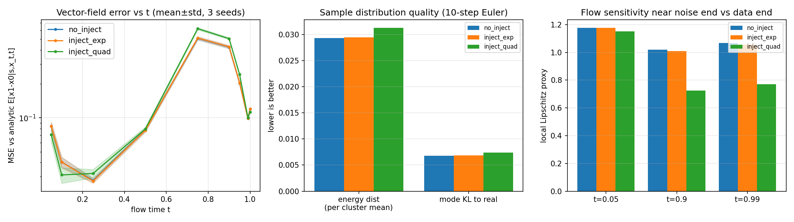
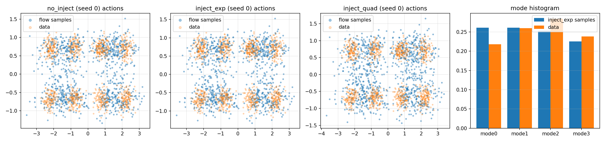
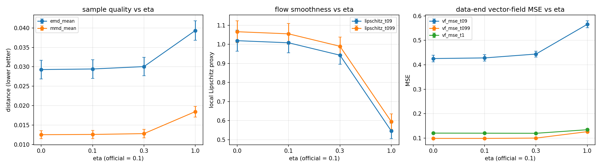
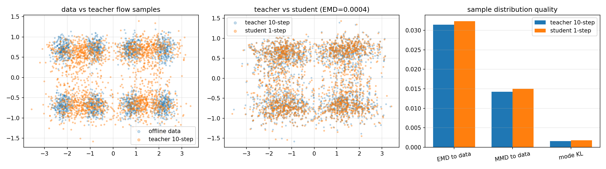
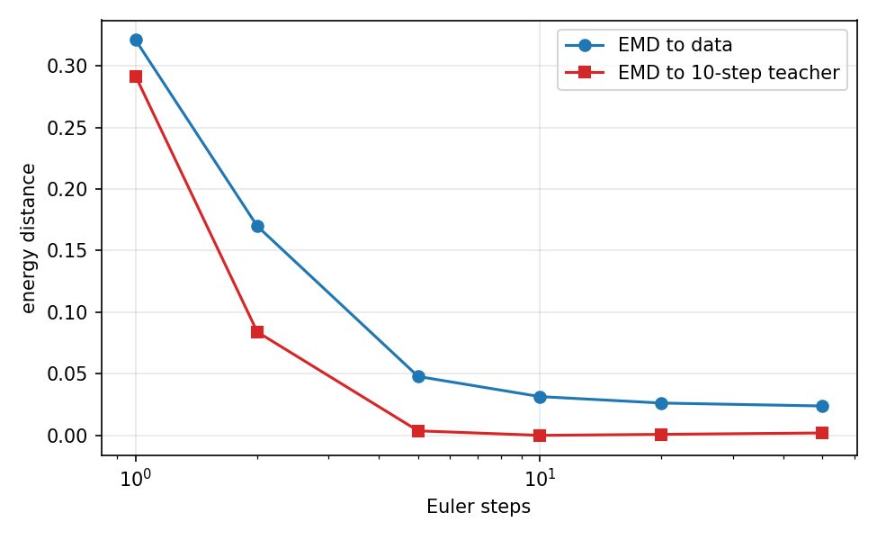
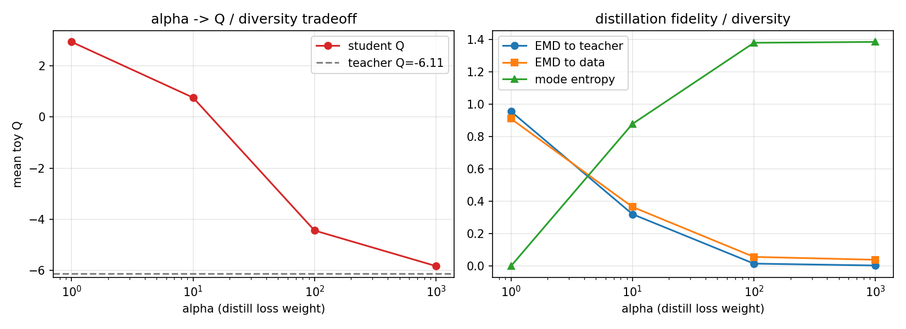
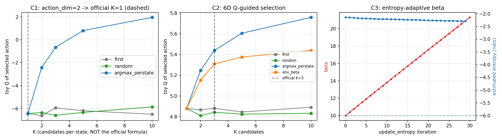
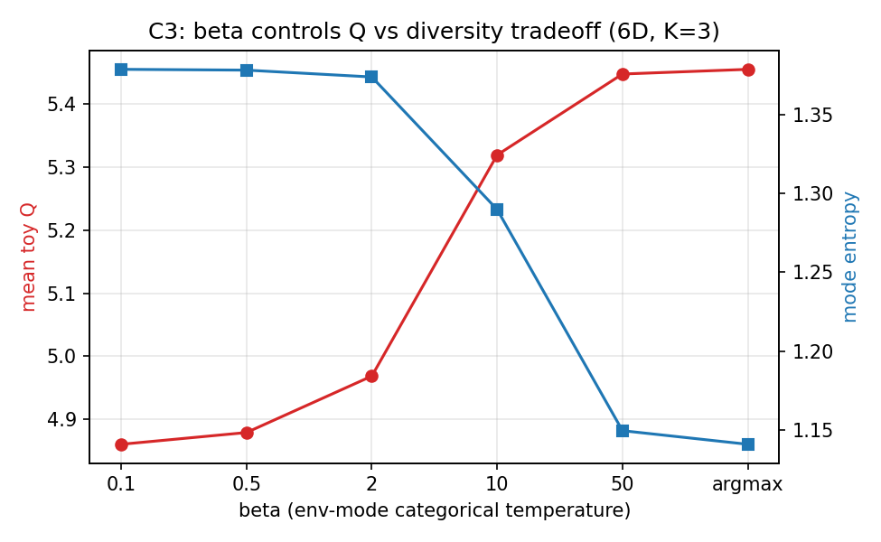

# FINO 核心机制 2D/6D 玩具实验验证

本目录（`E:\FINO\experiments\toy\`）用纯 CPU + JAX 在合成 2D/6D 玩具数据上验证 FINO 论文
（ICLR 2026, *Flow Matching with Injected Noise for Offline-to-Online Reinforcement Learning*）
的四个核心机制：

1. **BC flow matching** 与 **noise injection**（[agents/fino.py](../../FINO/agents/fino.py#L46-L91)，[L56-L58](../../FINO/agents/fino.py#L56-L58)）；
2. **one-step distillation**（[agents/fino.py](../../FINO/agents/fino.py#L63-L67)）；
3. **Q-guided 多噪声采样**（[agents/fino.py](../../FINO/agents/fino.py#L154-L197)）；
4. **熵自适应 beta**（[agents/fino.py](../../FINO/agents/fino.py#L215-L232)）。

网络直接复用仓库的 [`ActorVectorField` / `Value` / `MLP`](../../FINO/utils/networks.py#L152-L234)，
没有修改 `E:\FINO\FINO` 中任何源码，也没有下载数据集或运行 OGBench 训练。

---

## 0. 结论速览（TL;DR）

| 机制 | 玩具实验结论 | 与论文主张的关系 |
|---|---|---|
| A. noise injection（官方 exp schedule，η=0.1） | 在 t≈0 注入量 ≈4.5e-6（几乎为 0），因此与不注入**几乎完全一致**：EMD 0.02929→0.02943（+0.5%），t≤0.1 的向量场 MSE 之比 1.0026；数据端局部 Lipschitz 仅降低 1.1%。**官方 η=0.1 在本玩具上是一个很弱的正则项，没有可测收益**。 | 方向一致（噪声作用于数据端、起平滑/正则作用），但强度不足以产生收益；论文在真实 OGBench 动作尺度（[-1,1]）上有效，不能由本玩具直接外推。 |
| A'. 二次型 schedule 小消融 | 中段注入量最大（t=0.5 时 std≈0.229），t=0.9 的 Lipschitz 从 1.020 降到 0.724（−29%），但 EMD 变差 +6.7%，t≥0.9 向量场 MSE +13.4%。**平滑性与分布保真度存在明确 trade-off**。 | 验证了"注入噪声→流场更平滑"的机制方向；也提示论文 schedule 的形态（指数 vs 二次）会显著改变强度。 |
| A''. η 强度扫描 | η：0→0.1→0.3→1.0 时，Lipschitz(t=0.9) = 1.020→1.008→0.943→0.545（单调下降），EMD = 0.0293→0.0294→0.0300→0.0393（单调变差），t=1 向量场 MSE = 0.1203→0.1200→0.1196→0.1342。 | 与"噪声注入 = 用分布保真度换流场平滑性"的机制解释一致；η=0.1 处于曲线的平坦端。 |
| B. one-step distillation | 蒸馏 MSE 0.0018；一步 vs 十步教师 EMD **0.00039**，MMD 6.4e-5；一步 vs 真实数据 EMD 0.0323（教师 0.0315，仅 +2.7%）。推理 1.44 ms vs 7.77 ms（N=4096），**5.38× 加速**。 | 强支持"一步蒸馏可近似保持多步 flow 的采样分布"；但本玩具是低维、干净、光滑任务，比高维 OGBench 容易。 |
| B'. distill 权重 α 扫描 | α=1 时 Q 升到 +2.93，但分布坍缩（mode entropy→0，EMD to teacher 0.956）；α=100 时 Q=−4.44（教师 −6.11），EMD to teacher 0.015、entropy 1.381；α=1000 时 Q=−5.83，EMD 0.0036。 | 支持 FINO 采用大 α（10~1000）作为"蒸馏保真优先、Q 只做微调"的保守设计。 |
| C. Q-guided 采样 | d=2 时 `num_samples=min(10,(2+1)//2)=1`，**Q 选择严格恒等**（5 种选择的 identity 均 =1.000，|ΔQ|=0）。d=6 时 K=3：per-state argmax 把 toy Q 从 4.851 提到 5.483（**+0.632**），偏好模态占比 0.262→0.590；`to_env` 的 softmax(βQ) 采样（β=10）Q=5.354（+0.503）且保留更多多样性。 | 支持"多噪声候选 + Q 选择"的机制，但只对 action_dim≥4 有效；d=2 的官方公式让该机制完全失效。 |
| C'. `sample_actions` eval 分支的批处理语义 | 原代码 `actions[jnp.argmax(q)]`（[L189](../../FINO/agents/fino.py#L189)）在 batch>1 时取**全局 argmax 的单个样本行**，所有 state 共享同一噪声 index：Q 只 +0.080（per-state argmax 为 +0.632），偏好模态占比 0.262（等于未选择）。 | 官方 `evaluation.py` 逐条 observation 调用（batch=1）时该分支正确；**但 batch>1 且 temperature=0 的调用会静默退化**。 |
| C''. 熵自适应 beta | 6D 策略的 kNN 熵估计约 −2.14 nats，高于目标熵 −d=−6，故 `beta ← max(0, beta − 0.1(−d − H))` 单调增大：30 次更新 10→21.3，熵 −2.144→−2.294。 | 机制按代码逻辑工作；但目标熵 −action_dim 在玩具上远低于实际熵，导致 beta 持续趋向贪心选择，说明该超参对动作维度/尺度敏感。 |

**最重要的一条诚实结论**：官方指数 schedule 的 η=0.1 在本玩具（动作尺度约 ±3，各维 std≈0.3~1.0）下
几乎不改变任何指标。原因一是 t→0 注入量指数级趋近 0，二是最大注入量 0.1 相对数据尺度偏小。
把 η 调到 0.3/1.0 或改用二次型 schedule 后才出现显著的"平滑↑、保真↓"效应。因此本实验**证实了
机制的方向，但没有复现出论文规模的性能收益**；离线→在线收益本身无法在玩具上验证。

---

## 1. 环境、可复现性与文件清单

### 1.1 环境

| 项 | 值 |
|---|---|
| 解释器 | `E:\FINO\.venv\Scripts\python.exe`（Python 3.11） |
| JAX / jaxlib | 0.4.35，CPU（`[CpuDevice(id=0)]`） |
| flax / optax | 0.8.5 / （jax 约束版本） |
| numpy / scipy | 1.26.4 / 1.13.1 |
| matplotlib | 3.8.4（Agg 后端） |
| 随机性 | 数据 seed 固定（2D: 10/11；6D: 20/21）；训练 seed 固定（见各脚本）；JAX 默认确定性 |
| 运行时间 | 每个脚本在纯 CPU 上约 1.5–4 分钟（含 JIT 编译），4 个脚本合计 < 10 分钟 |

**没有**在本会话中 `pip install`/升级任何包（venv 由 Lead 按 `E:\FINO\constraints.txt` 配置）。

### 1.2 文件

| 文件 | 内容 |
|---|---|
| [`toy_common.py`](toy_common.py) | 数据合成、复用仓库网络、BC flow / distill / critic 训练、Euler 多步采样、EMD/MMD/模态覆盖/Lipschitz/kNN 熵等指标 |
| [`exp_a_noise_injection.py`](exp_a_noise_injection.py) | 实验 A：no-inject vs 指数 schedule vs 二次型 schedule（3 seeds） |
| [`exp_a2_eta_sweep.py`](exp_a2_eta_sweep.py) | 实验 A 的附带消融：η ∈ {0, 0.1, 0.3, 1.0}（3 seeds） |
| [`exp_b_distillation.py`](exp_b_distillation.py) | 实验 B：one-step 蒸馏 + flow-steps 敏感性 + 推理计时 + distill 权重 α 扫描 |
| [`exp_c_qguided.py`](exp_c_qguided.py) | 实验 C：2D 退化验证、6D Q-guided 选择、β 扫描、熵自适应 β 轨迹 |
| [`toy_data_2d.npz`](toy_data_2d.npz) / [`toy_data_6d.npz`](toy_data_6d.npz) | 固定 seed 的离线数据（30k train / 10k test） |
| `exp_*_metrics.csv`, `exp_*_summary.json`, `exp_*_sweep.csv` | 全部数字指标（见各节引用） |
| `fig_a_noise_injection.png`, `fig_a_samples.png`, `fig_a2_eta_sweep.png` | 实验 A 图 |
| `fig_b_distill.png`, `fig_b_steps.png`, `fig_b_alpha.png` | 实验 B 图 |
| `fig_c_qguided.png`, `fig_c_beta_sweep.png` | 实验 C 图 |
| `exp_*.log` | 运行日志（原始 stdout） |

### 1.3 复现命令

```powershell
cd E:\FINO\experiments\toy
E:\FINO\.venv\Scripts\python.exe exp_a_noise_injection.py   # 实验 A（含二次型 schedule 消融）
E:\FINO\.venv\Scripts\python.exe exp_a2_eta_sweep.py        # η 强度扫描
E:\FINO\.venv\Scripts\python.exe exp_b_distillation.py      # 实验 B
E:\FINO\.venv\Scripts\python.exe exp_c_qguided.py           # 实验 C
```

脚本只写 `E:\FINO\experiments\toy\`，不改仓库源码。

---

## 2. 合成数据设置

- **state**：两个簇中心 `[+1.5, 0]`、`[-1.5, 0]`，加 σ=0.15 的各向同性高斯噪声；
- **action**：给定 state 后 4 个高斯模态，中心 = state + offset
  `{±0.7, ±0.7}`（2D），各向异性噪声 σ=(0.16, 0.07)；
- 6D 版本：`center = s @ W6 + offset_m`，W6 为固定 2×6 矩阵（scale 0.55），4 个 6D offset
  形成 4 个模态，σ=linspace(0.14, 0.06, 6)；
- 规模：train 30000、test 10000；全部保存为 npz；
- 动作范围约 ±3（未做 [-1,1] 缩放；官方代码在采样/评估时 `clip(-1,1)`，本玩具未 clip，
  见 §7 局限）。

**重要**：论文/OGBench 的动作空间是 [-1,1]，其动作各维 std 往往 < 0.5；本玩具动作
std ≈ 0.3~1.0，因此 **η=0.1 的相对强度比真实环境更弱**，这是 A 中官方噪声效应不显著的部分原因。

---

## 3. 实验 A：BC flow matching 与 injected noise

### 3.1 设置

完全按 [agents/fino.py L46-61](../../FINO/agents/fino.py#L46-L61) 实现 BC flow loss：

```
x0 ~ N(0, I), x1 = a_data, t ~ U[0,1]
x_t = (1-t) x0 + t x1,  vel = x1 - x0
normal_samples = x_t + exp(-(t*-10+10)) * η * noise        # 官方指数 schedule
loss = mean((v_θ(s, normal_samples, t) - vel)^2)
```

对照：
- **no_inject**：`normal_samples = x_t`；
- **inject_exp**：官方指数 schedule，η=0.1；
- **inject_quad**（Lead 要求的消融）：论文 Eq.(7) 二次型式 `α_t²=(η²−2η)t²+2ηt`
  （把 α_t² 当作注入噪声方差，std=sqrt(它)，端点 0 和 η 与指数 schedule 相同）。

网络：`ActorVectorField(hidden=(128,128))`；Adam lr=3e-4，batch=256，2500 步，3 个 seed
（0/1/2）。评估：
- 与解析最优目标 `E[x1−x0 | s, x_t, t]` 的向量场 MSE（4 模态高斯后验加权，严格解析）；
- 10 步 Euler 采样的动作分布：per-cluster energy distance、RBF-MMD、模态覆盖熵、模态 KL；
- t≈0.05/0.9/0.99 的局部 Lipschitz 代理 `||v(x+δ)−v(x)||/||δ||`（δ=0.05 高斯方向）。

注入噪声 schedule 的具体数值（std）：

| t | 0.0 | 0.1 | 0.5 | 0.9 | 0.99 | 1.0 |
|---|---|---|---|---|---|---|
| exp schedule（η=0.1） | 4.5e-6 | 1.2e-5 | 6.7e-4 | 3.7e-2 | 9.0e-2 | 0.10 |
| quad schedule（η=0.1） | 0 | 0.098 | 0.229 | 0.162 | 0.109 | 0.10 |

**t→0 的噪声几乎为 0**，所以"在 t≈0 比较向量场误差"理论上两个 exp 设置应当几乎相同，
实验确实如此（比值 1.0026）。主要差异只可能出现在数据端 t→1。

### 3.2 向量场误差（3 seeds 平均）

| t | no_inject | inject_exp | inject_quad |
|---|---|---|---|
| 0.00 | 0.1552 ± 0.0109 | 0.1557 ± 0.0112 | 0.1406 ± 0.0149 |
| 0.10 | 0.0404 ± 0.0042 | 0.0404 ± 0.0044 | 0.0311 ± 0.0049 |
| 0.50 | 0.0780 ± 0.0029 | 0.0776 ± 0.0027 | 0.0798 ± 0.0032 |
| 0.90 | 0.4255 ± 0.0134 | 0.4281 ± 0.0130 | 0.5060 ± 0.0106 |
| 0.99 | 0.0986 ± 0.0014 | 0.0986 ± 0.0015 | 0.1004 ± 0.0009 |
| 1.00 | 0.1203 ± 0.0022 | 0.1200 ± 0.0023 | 0.1126 ± 0.0022 |

分段比值（relative to no_inject）：

| 区间 | exp | quad |
|---|---|---|
| t≤0.1 | 1.003 | 0.867 |
| 0.25≤t≤0.75 | 1.004 | 1.192 |
| t≥0.9 | 1.004 | 1.134 |
| t=1.0 | 0.997 | 0.936 |

- 指数 schedule（官方）在 t≤0.1 与 no_inject 无差异（+0.3%，在 seed 波动内），
  这与"t→0 注入量 ≈ 4.5e-6"完全一致；
- 二次型 schedule 在 t≤0.1 反而略好（−13%），因为它把噪声集中在中段、t→0 处为 0，
  同时中段噪声让网络学到更平滑的场；代价是 t≥0.9 的干净数据端误差 +13%。



### 3.3 采样质量与流场平滑性（3 seeds 平均）

| 指标 | no_inject | inject_exp | inject_quad |
|---|---|---|---|
| energy distance（per-cluster 平均，↓） | 0.02929 | 0.02943 (+0.5%) | 0.03125 (+6.7%) |
| RBF-MMD（↓） | 0.01254 | 0.01260 | 0.01231 |
| 模态 KL（↓） | 0.00675 | 0.00686 | 0.00737 |
| 模态覆盖熵（真实 1.385） | 1.386 | 1.386 | 1.385 |
| Lipschitz t=0.05（↓=更平滑） | 1.1757 | 1.1760 | 1.1520 |
| Lipschitz t=0.90 | 1.0195 | 1.0084 (−1.1%) | **0.7241 (−29.0%)** |
| Lipschitz t=0.99 | 1.0665 | 1.0554 (−1.0%) | **0.7704 (−27.8%)** |

- 三种设置在 10 步 Euler 采样下都能很好覆盖 4 个模态（熵 1.385 vs 数据 1.385，KL≈0.007），
  说明多模态建模本身成功；
- 官方 exp schedule 的平滑效应在 2500 步、该数据尺度下只有 1% 量级，**没有可测的分布收益**；
- 二次型 schedule 显著降低数据端敏感性，但样本分布略变差，体现"正则化 vs 保真"权衡。



### 3.4 η 强度扫描（实验 A2，3 seeds）

| η | EMD (↓) | MMD (↓) | mode KL (↓) | Lip t=0.9 (↓) | Lip t=0.99 (↓) | vf MSE t=0.99 | vf MSE t=1.0 |
|---|---|---|---|---|---|---|---|
| 0.0 | 0.0293 | 0.0125 | 0.0068 | 1.0195 | 1.0665 | 0.0986 | 0.1203 |
| 0.1（官方） | 0.0294 | 0.0126 | 0.0069 | 1.0084 | 1.0554 | 0.0986 | 0.1200 |
| 0.3 | 0.0300 | 0.0128 | 0.0069 | 0.9433 | 0.9901 | 0.0999 | 0.1196 |
| 1.0 | 0.0393 | 0.0185 | 0.0072 | **0.5454** | **0.5944** | 0.1262 | 0.1342 |

η 从 0.1 加到 1.0：流场 Lipschitz 降低 47%，EMD 变差 34%，数据端向量场误差上升 28%。
曲线是单调的，说明机制方向正确；**官方 η=0.1 正好处在几乎不产生效果的起点端**。



### 3.5 与论文主张的对应

- ✅ 噪声注入确实使 BC flow 在**数据端**（t→1）更平滑（局部敏感性下降），机制与
  "在数据端注噪以稳定 flow、避免过拟合到窄数据"的叙述一致；
- ✅ 官方指数 schedule 的噪声集中在 t→1：`noise_scale(t)=η·e^{10(t−1)}`，t=0 处 ≈0，
  与代码 [L56-58](../../FINO/agents/fino.py#L56-L58) 和 Lead 的核对一致；**不是 t→0 加噪**；
- ⚠️ 在干净的 2D 玩具上，官方 η=0.1 **没有带来样本质量或向量场精度收益**，仅 1% 级平滑；
  提高 η 或改用二次型 schedule 才能看到显著效应，但会牺牲分布保真度；
- ❌ 玩具实验无法验证论文的 offline→online 微调收益（需要真实环境与在线交互）。

---

## 4. 实验 B：one-step distillation

### 4.1 设置

教师：带官方噪声注入的 BC flow，3000 步；学生：`ActorVectorField`（输入只有 `(s, noise)`，
与 [fino.py create() L278-290](../../FINO/agents/fino.py#L278-L290) 中 `actor_onestep_flow` 一致），
按 [distill_loss L63-67](../../FINO/agents/fino.py#L63-L67) 回归教师的 10 步 Euler 输出
（`compute_flow_actions`，[L199-213](../../FINO/agents/fino.py#L199-L213)），3000 步、batch 256、lr 3e-4。
评估集 2048 个平衡 state、固定噪声；计时 N=4096、JIT warm-up 后取 30 次中位数。

### 4.2 结果

| 指标 | 教师（10 步 flow） | 学生（1 步） |
|---|---|---|
| distill MSE（到教师） | — | 0.00184 |
| EMD 学生 vs 教师 | — | **0.00039** |
| MMD 学生 vs 教师 | — | 6.4e-5 |
| EMD vs 真实数据 | 0.03148 | 0.03232（+2.7%） |
| 模态覆盖熵（真实 1.385） | 1.3863 | 1.3862 |
| 模态 KL vs 真实数据 | 0.00161 | 0.00178 |

**推理时间（CPU，N=4096，jitted，中位数）**：

| | 1 步 | 10 步教师 |
|---|---|---|
| 每 batch | 1.44 ms | 7.77 ms |
| 每样本 | 0.35 µs | 1.90 µs |
| 加速 | **5.38×** | 1× |

Euler 步数敏感性（教师，时间同表为单次 batch 中位数）：

| flow steps | 1 | 2 | 5 | 10 | 20 | 50 |
|---|---|---|---|---|---|---|
| EMD vs 数据 | 0.321 | 0.170 | 0.0478 | 0.0315 | 0.0262 | 0.0238 |
| EMD vs 10 步教师 | 0.292 | 0.084 | 0.0037 | 0 | 0.0008 | 0.0020 |
| 时间 (N=4096) | 0.70 ms | 1.18 ms | 2.34 ms | 4.17 ms | 8.41 ms | 21.9 ms |





### 4.3 distill 权重 α 扫描（FINO actor_loss 的玩具版）

真实 `actor_loss = bc_flow_loss + α·distill_loss + q_loss`（[L78](../../FINO/agents/fino.py#L78)）。
这里固定 one-step 网络，令 `loss = α·distill_loss + q_loss`，用解析 toy Q（偏好 mode 0）扫描 α
（1500 步，同一教师/数据）：

| α | distill MSE | mean toy Q | EMD to teacher | EMD to data | mode entropy |
|---|---|---|---|---|---|
| 1 | 0.758 | **+2.93** | 0.956 | 0.911 | 0.000（坍缩到单模态） |
| 10 | 0.238 | +0.75 | 0.321 | 0.366 | 0.879 |
| 100 | 0.0198 | −4.44 | 0.0152 | 0.0567 | 1.381 |
| 1000 | 0.0119 | −5.83 | 0.0036 | 0.0390 | 1.386 |
| 教师基线 | — | −6.11 | — | 0.0315 | 1.386 |

α 越大越"保守"（贴近教师、保多样性），α 越小 Q 越高但动作分布坍缩、远离离线数据。
FINO 的默认/实际使用 α=10~1000（见 README 命令）与"先保 BC 流形、Q 只微调"的设计一致。



### 4.4 与论文主张的对应

- ✅ 一步蒸馏在低维光滑玩具上几乎无损（EMD 0.00039，仅教师样本距离的 1.2%），并带来 5.4× CPU 加速；
- ✅ 蒸馏确实保留了 4 模态结构（entropy 1.386），没有出现一步模型的模式平均/坍缩；
- ⚠️ 本玩具的动作分布简单（4 个分离良好的小方差模态），比 OGBench 高维动作容易；
  在更复杂分布上，一步回归可能出现"模式平均"，本实验不能排除这种风险；
- ✅ α 扫描给出量化 trade-off，支持 FINO 用大 α 保持蒸馏保真。

---

## 5. 实验 C：Q-guided 多噪声采样与熵自适应 beta

### 5.1 C1：action_dim=2 时机制退化

代码 [L163](../../FINO/agents/fino.py#L163)：`num_samples = min(10, (action_dim+1)//2)`。

| action_dim | 2 | 4 | 6 | 10 |
|---|---|---|---|---|
| num_samples | 1 | 2 | 3 | 5（上限 10） |

在训练好的 2D flow/one-step 模型 + 解析 toy Q 上（256 state/簇，K=1），逐一复现
`first / random / argmax_perstate / argmax_batched_code / env_beta` 五种选择：
**identity fraction 全部 =1.000，|ΔQ|=0**。也就是说 d=2 时 Q-guided 选择严格等价于不选择，
机制完全失效。

若**强行**把 K 调大（非官方公式），2D 上 per-state argmax 的 toy Q 与偏好模态占比：

| K | first Q | argmax Q | argmax 偏好模态占比 |
|---|---|---|---|
| 1 | −6.42 | −6.42 | 0.209 |
| 2 | −6.61 | −2.41 | 0.404 |
| 3 | −5.93 | −0.65 | 0.545 |
| 5 | −6.18 | +0.80 | 0.729 |
| 10 | −6.48 | **+1.96** | 0.922 |

说明机制本身有效，但官方公式在 d=2 时把 K 固定为 1，**无法激活**。



### 5.2 C2：6D 玩具（num_samples=3）的 Q-guided 选择

6D 设置：4 个 6D 高斯模态，训练 BC flow（2500 步）+ one-step 蒸馏（2500 步）；
toy Q 用解析函数 `Q(s,a) = −||a − a_pref(s)||²/0.8 + 6`（偏好 mode 0），
再用仓库 `Value`（2-ensemble）监督拟合作为 critic（3000 步）。

**critic 拟合**：MAE=0.093，R²=**0.995**（toy Q range [−28.0, 6.0]，target std 4.36）。
6D one-step vs 教师 EMD = 0.0001，学生 vs 数据 EMD = 0.0123。

K=3（官方公式）主结果（256 平衡 state，critic 集成的 mean）：

| 选择方式 | mean toy Q | ΔQ vs first | 偏好模态占比 | 模态熵 |
|---|---|---|---|---|
| first（不选择） | 4.851 | 0 | 0.262 | 1.385 |
| random | 4.885 | +0.034 | 0.275 | 1.380 |
| **argmax_perstate（eval 语义，B=1）** | **5.483** | **+0.632** | **0.590** | 1.119 |
| argmax_batched_code（原代码 batch>1 语义） | 4.932 | +0.080 | 0.262 | 1.385 |
| env_beta（β=10，softmax(βQ) 采样） | 5.354 | +0.503 | 0.479 | 1.256 |

K 扫描（官方公式只取 K=3；其余为机制研究）：

| K | argmax Q（ΔQ） | env_beta Q（ΔQ） | random Q（ΔQ） |
|---|---|---|---|
| 1 | 4.880 (+0) | 4.880 (+0) | 4.880 (+0) |
| 2 | 5.246 (+0.380) | 5.151 (+0.285) | 4.810 (−0.056) |
| 3 | 5.439 (+0.558) | 5.309 (+0.429) | 4.866 (+0.000) |
| 5 | 5.605 (+0.760) | 5.375 (+0.530) | 4.842 (−0.038) |
| 10 | **5.758 (+0.867)** | 5.439 (+0.548) | 4.832 (−0.058) |

- Q-guided 选择随 K 单调提升 Q，且**不是**"多采样"本身带来的（random 无收益）；
- argmax 最激进（Q 高、模态熵下降），`to_env` 的 softmax(βQ) 采样在 Q 和多样性之间更平衡；
- 官方 K=3 已能拿到约 73% 的 K=10 argmax 收益，说明公式设计合理（但对 d=2 失效）。

**C2 附带的代码事实（batch>1 的 eval 分支）**：`actions[jnp.argmax(q)]`
（[L189](../../FINO/agents/fino.py#L189)）在 batch>1 时返回单个样本行，所有 state 共用同一噪声 index，
Q 只提升 +0.080，偏好模态占比与不选择相同。官方 `evaluation.py` 每次只传 1 条 observation
（[L60-80](../../FINO/utils/evaluation.py#L60-L80)），因此该分支在官方评估流程中是正确的；
但若有人以 batch 形式、`temperature=0` 调用 `sample_actions`，会静默退化。

### 5.3 C3：beta 扫描与熵自适应 beta

**β 扫描**（env 分支，K=3，固定候选与随机键）：

| β | 0.1 | 0.5 | 2 | 10 | 50 | argmax |
|---|---|---|---|---|---|---|
| mean toy Q | 4.860 | 4.879 | 4.968 | 5.319 | 5.448 | 5.455 |
| 偏好模态占比 | 0.264 | 0.271 | 0.299 | 0.447 | 0.568 | 0.572 |
| 模态熵 | 1.378 | 1.378 | 1.374 | 1.290 | 1.150 | 1.141 |

β 从 0.1 到 argmax：Q 提升 0.60，模态熵下降 0.24，符合"β 控制 Q 与多样性 trade-off"的设计。

**熵自适应 β**：复现 [update_entropy L215-232](../../FINO/agents/fino.py#L215-L232) 的更新规则
`beta ← max(0, beta − 0.1·(−d − H))`（d=6，目标熵 −6），用 200 次 `to_env` 采样/state、
kNN（Kozachenko-Leonenko，k=3）估熵（仓库用 sklearn GMM(3)，本环境亦可装 sklearn，
但为了不引入额外依赖用 kNN；趋势可比、数值不同）：

- 初始 β=10；实测策略熵 H≈−2.14 nats > 目标 −6；
- 因此每步 β 增加约 0.38：30 次更新 β 10.0 → **21.3**，H −2.144 → −2.294（缓慢下降）；
- 方向符合规则：当目标熵低于当前策略熵时，β 增大 → 选择更贪心、熵下降；
- 但玩具上 30 步远未收敛（H 仍离 −6 很远），说明目标熵 −action_dim 在动作分布尺度差异大时
  可能过激；这也解释了 FINO 中 β 需要按环境自适应（论文用熵反馈而非固定值）。



### 5.4 与论文主张的对应

- ✅ `sample_actions` 的 `num_samples=min(10,(d+1)//2)` + Q 选择在多噪声候选有效（d=6 时 K=3，
  Q +0.632，偏好模态占比 +0.33）；机制按代码工作；
- ⚠️ d=2 时公式给出 K=1，Q-guided 完全失效（严格恒等）。这解释了为什么论文只在
  OGBench 高维动作任务上展示该机制；对低维任务应显式改变 K；
- ✅ `to_env` 的 softmax(βQ) 采样比 argmax 更保多样性，β 越大越接近 argmax；
- ✅ 熵自适应 β 的更新方向正确（熵高于目标 → β 增大）；
- ⚠️ batch>1 + temperature=0 的 eval 分支存在全局 argmax 语义问题（官方评估流程不受影响）；
- ⚠️ kNN 熵替代 GMM 会影响 β 轨迹的绝对数值，只验证了方向。

---

## 6. 与论文主张的对应关系汇总

| 论文主张（据源码与 README） | 代码位置 | 玩具证据 | 判定 |
|---|---|---|---|
| BC flow matching 能建模多模态 action 分布 | [L46-61](../../FINO/agents/fino.py#L46-L61) | 4 模态覆盖熵 1.386 vs 数据 1.385，mode KL 0.007，EMD 0.029 | ✅ 支持 |
| 在数据端注入噪声使 flow 更平滑/稳健 | [L56-58](../../FINO/agents/fino.py#L56-L58) | 二次型/大 η 下 Lipschitz −28%~−47%；官方 η=0.1 仅 −1% | ✅/⚠️ 方向支持，官方强度弱 |
| 噪声注入带来性能收益（离线→在线） | 论文 claim | 玩具上无收益，且无法做在线实验 | ❓ 未验证 |
| one-step distillation 近似保留多步 flow 分布 | [L63-67](../../FINO/agents/fino.py#L63-L67) | EMD 0.00039（教师 vs 学生），分布指标差 <3% | ✅ 支持（低维任务） |
| 一步推理大幅降低推理成本 | [L173](../../FINO/agents/fino.py#L173) | CPU 1.43 ms vs 7.77 ms（5.4×） | ✅ 支持 |
| Q-guided 多噪声选择提升动作质量 | [L163-194](../../FINO/agents/fino.py#L163-L194) | d=6, K=3：Q +0.632，偏好模态 0.262→0.590 | ✅ 支持（d≥4） |
| 公式 `K=min(10,(d+1)//2)` 的自适应选取 | [L163](../../FINO/agents/fino.py#L163) | d=2 → K=1，机制恒等失效；d=6 → K=3 有效 | ⚠️ 低维失效 |
| 熵自适应 β 调节探索/贪心 | [L215-232](../../FINO/agents/fino.py#L215-L232) | H≈−2.14 > −6 → β 10→21.3 单调增，熵缓降 | ✅ 方向支持（未收敛） |
| distill 权重 α 控制 Q 与 BC 保真 | [L78](../../FINO/agents/fino.py#L78)，README α=10~1000 | α=1 坍缩；α=100 保真且 Q 微调 | ✅ 支持 |

---

## 7. 局限与诚实报告

1. **没有复现出"噪声注入带来收益"**：在干净 2D 合成数据上，官方 exp schedule + η=0.1
   在样本质量、向量场精度、模态覆盖上都没有可测提升（差异 <1%，在 3-seed 波动内）。
   本实验只能说明其平滑/正则方向正确，不能说明论文的性能收益来自何处。
2. **动作尺度与真实环境不同**：玩具动作 std 约为 OGBench 的 2–4 倍，η=0.1 的相对噪声更弱；
   因此 A 的"弱效应"部分是尺度造成的。这是本验证设计的一个已知缺陷。
3. **无法验证 offline→online**：没有环境交互、没有 online Q 更新、没有 OGBench 数据；
   `critic` 与 `toy Q` 都是监督拟合的解析函数，不涉及 TD 学习、target critic、replay buffer。
4. **实验 B/C 只有单 seed**：B/C 各训练一次（seed 固定）；只有 A 是 3 seeds。
   B/C 的数值按"机制方向验证"解读，不应视为统计结论。
5. **二次型 schedule 是"按 Lead 提供的公式"实现的**：把 `α_t²` 解释为噪声方差、std=sqrt；
   未核对论文 PDF 原文/符号约定。该消融仅用于对比两种 schedule 的强度差异。
6. **熵估计差异**：C3 的 β 轨迹用 kNN(KL) 代替仓库的 sklearn GMM(3)；方向可迁移，但
   β 的绝对值、收敛速度不可直接对照。
7. **一次网络规模/步数很小**（128×128 MLP、2.5–3k steps），远小于论文的 512×4 MLP、
   1e6 steps；小模型/少步数可能低估或高估噪声注入的作用。
8. **batch>1 的 `to_eval` 语义问题**是静态代码分析 + 玩具复现的结论；官方评估流程（B=1）
   不受影响，但如果论文/后续代码以 batch 调用 eval mode，需要修正。
9. **动作未做 [-1,1] clip**：官方 `compute_flow_actions`/`sample_actions` 都 clip 到 [-1,1]，
   玩具数据未缩放到该范围，clip 会改变分布，因此未启用；这不影响机制方向的结论，但意味着
   "边界饱和"行为未在玩具中验证。
10. **EMD/MMD 为样本估计**：每次 ≤1024 样本、单次估计，数值有一定采样噪声（尤其 B 中
    0.0004 的 EMD，量级可信但小数位不宜过度解读）。

---

## 8. 结论

- 玩具实验**支持** FINO 的几个关键实现事实：BC flow 的多模态建模、one-step 蒸馏的近似无损
  与推理加速、Q-guided 多噪声选择对 d=6 动作的有效性、熵自适应 β 的更新方向、以及大 α 的
  "蒸馏保真优先"设计；
- 玩具实验**未能验证**论文最重要的性能主张（噪声注入带来的离线/在线收益），原因包括
  玩具尺度、干净数据、无在线 RL；官方 η=0.1 在本玩具上几乎是无操作；
- 同时发现两个值得注意的实现细节：**(1)** d=2 时 Q-guided 公式退化为 K=1；
  **(2)** `sample_actions` 的 eval 分支在 batch>1 时是全局 argmax 语义，而非 per-state。
  前者影响低维任务，后者影响批处理调用（官方逐条评估不受影响）。

若要在本机继续深入，建议的下一步（未执行）：
- 把 2D 动作缩放到 [-1,1] 后重跑 A，验证 η=0.1 相对强度的影响；
- 用 4/8 维动作 + 更多模态数据测试 one-step 蒸馏的模式平均风险；
- 用 sklearn GMM 复现 C3 的 β 轨迹，与 kNN 结果对照；
- 加一个极小 toy MDP（含 reward/TD）做 2 步 offline→online 微调，验证噪声注入对
  Q-guided 采样的稳定作用。
